# node-cli

[](https://github.com/libraz/node-cli/actions)
[](https://www.npmjs.com/package/@libraz/node-cli)
[](https://codecov.io/gh/libraz/node-cli)
[](https://github.com/libraz/node-cli/blob/main/LICENSE)
[](https://www.typescriptlang.org/)
[](https://nodejs.org/)

Zero-dependency, batteries-included CLI framework for Node.js / TypeScript.



Define a command once and it works two ways: as `myapp deploy prod` typed at a shell, and as `deploy prod` typed at your tool's own interactive prompt. Around that sit the parts a command-line tool usually needs — options, subcommands, tab completion, colour, tables, progress bars, prompts and a logger — with no runtime dependencies to install.

## What you get

- Commands, subcommands, aliases, and typed options with defaults, choices and validation
- An interactive shell with persistent history, tab completion, pipes, and mode sub-REPLs
- Colour, tables, progress bars, spinners, prompts and a logger, each usable on its own
- Lifecycle events and plugins for cross-cutting behaviour
- TypeScript and ESM first, no production dependencies

## Install

Node.js 22 or later, ESM only. The type definitions need TypeScript 5.4 or later.

```bash
npm install @libraz/node-cli
```

## Quick start

```typescript
#!/usr/bin/env node
import { createCLI } from "@libraz/node-cli";

const cli = createCLI({ name: "myapp", version: "1.0.0" });

cli
  .command("greet <name>")
  .description("Greet someone")
  .option("-u, --uppercase", { type: "boolean" })
  .action((ctx) => {
    const { name } = ctx.args;
    ctx.stdout.write(`Hello, ${ctx.options.uppercase ? name.toUpperCase() : name}!\n`);
  });

await cli.start();
```

Run it with arguments and it executes one command and exits:

```bash
$ myapp greet World --uppercase
Hello, WORLD!
```

Run it with none, from a terminal, and the same command is available at an interactive prompt:

```bash
$ myapp
myapp v1.0.0
> greet World
Hello, World!
> exit
```

[Getting started](docs/en/getting-started.md) covers the rest of the setup — the `bin` entry, the build step, and making `myapp` available on your path.

## Documentation

Start with [Introduction](docs/en/introduction.md) for the mental model, or [Getting started](docs/en/getting-started.md) to build a working tool end to end. New to command-line development? The [glossary](docs/en/glossary.md) defines every term the docs use.

| Topic | Pages |
|---|---|
| Building commands | [Commands](docs/en/commands.md) · [Options](docs/en/options.md) · [Errors](docs/en/errors.md) |
| The interactive shell | [Interactive shell](docs/en/interactive-shell.md) |
| Output | [Colour](docs/en/color.md) · [Tables](docs/en/table.md) · [Progress](docs/en/progress.md) · [Prompts](docs/en/prompts.md) · [Logging](docs/en/logging.md) |
| Extending | [Events and plugins](docs/en/events-and-plugins.md) |
| Reference | [API reference](docs/en/api-reference.md) · [Examples](docs/en/examples.md) · [Glossary](docs/en/glossary.md) |

Ten runnable examples live in [`examples/`](examples/).

## What it does not do

- **ESM only.** There is no separate CommonJS build. Node.js 22.12 and later can `require()` the ES module; earlier 22.x releases need `await import("@libraz/node-cli")`.
- **No shell completion scripts.** Tab completion works inside the tool's own interactive shell. Completion for bash, zsh or fish is not generated.
- **No configuration-file loading.** Reading a config file, merging it with options, and resolving precedence is left to the application.
- **No positional-argument coercion.** Positional arguments arrive as strings; types, defaults and choices exist on options only.
- **Built-in messages are English.** Help output and error text are not translated.

## License

[MIT](LICENSE)
