# node-cli

[](https://github.com/libraz/node-cli/actions)
[](https://www.npmjs.com/package/@libraz/node-cli)
[](https://codecov.io/gh/libraz/node-cli)
[](https://github.com/libraz/node-cli/blob/main/LICENSE)
[](https://www.typescriptlang.org/)
[](https://nodejs.org/)

Node.js / TypeScript 向けの、依存パッケージゼロで一通り揃った CLI フレームワークです。



コマンドを一度定義すると、それが 2 通りの使い方になります。シェルから `myapp deploy prod` と打つ使い方と、ツール自身の対話プロンプトで `deploy prod` と打つ使い方です。その周りに、コマンドラインツールに必要になるもの — オプション、サブコマンド、タブ補完、カラー、テーブル、プログレスバー、プロンプト、ロガー — が揃っていて、追加でインストールする実行時依存はありません。

## できること

- コマンド、サブコマンド、エイリアス、および既定値・選択肢・検証を持つ型付きオプション
- 永続的な履歴、タブ補完、パイプ、モードサブ REPL を備えた対話シェル
- カラー、テーブル、プログレスバー、スピナー、プロンプト、ロガー（いずれも単体で利用可能）
- 横断的な処理を追加するためのライフサイクルイベントとプラグイン
- TypeScript と ESM を前提とした設計、実行時依存なし

## インストール

Node.js 22 以降、ESM 専用です。

```bash
npm install @libraz/node-cli
```

## クイックスタート

```typescript
#!/usr/bin/env node
import { createCLI } from "@libraz/node-cli";

const cli = createCLI({ name: "myapp", version: "1.0.0" });

cli
  .command("greet <name>")
  .description("Greet someone")
  .option("-u, --uppercase", { type: "boolean" })
  .action((ctx) => {
    const name = ctx.args.name as string;
    ctx.stdout.write(`Hello, ${ctx.options.uppercase ? name.toUpperCase() : name}!\n`);
  });

await cli.start();
```

引数を付けて実行すると、コマンドを 1 つ実行して終了します。

```bash
$ myapp greet World --uppercase
Hello, WORLD!
```

引数なしで端末から実行すると、同じコマンドを対話プロンプトで使えます。

```bash
$ myapp
myapp v1.0.0
> greet World
Hello, World!
> exit
```

残りのセットアップ — `bin` エントリ、ビルド手順、`myapp` を PATH から使えるようにする方法 — は[入門](docs/ja/getting-started.md)で説明します。

## ドキュメント

考え方を把握するには[はじめに](docs/ja/introduction.md)から、動くツールを一通り作るには[入門](docs/ja/getting-started.md)から読み進めてください。コマンドライン開発が初めての場合は、ドキュメントで使う用語を[用語集](docs/ja/glossary.md)にまとめてあります。

| 分野 | ページ |
|---|---|
| コマンドを作る | [コマンド](docs/ja/commands.md) · [オプション](docs/ja/options.md) · [エラー](docs/ja/errors.md) |
| 対話シェル | [対話シェル](docs/ja/interactive-shell.md) |
| 出力 | [カラー](docs/ja/color.md) · [テーブル](docs/ja/table.md) · [プログレス](docs/ja/progress.md) · [プロンプト](docs/ja/prompts.md) · [ロギング](docs/ja/logging.md) |
| 拡張する | [イベントとプラグイン](docs/ja/events-and-plugins.md) |
| リファレンス | [API リファレンス](docs/ja/api-reference.md) · [実例](docs/ja/examples.md) · [用語集](docs/ja/glossary.md) |

実行可能なサンプルが [`examples/`](examples/) に 10 本あります。

## 対象外のこと

- **ESM 専用。** CommonJS ビルドはないため、`require("@libraz/node-cli")` は動作しません。
- **シェル補完スクリプトの生成なし。** タブ補完はツール自身の対話シェル内で動作します。bash・zsh・fish 向けの補完スクリプトは生成しません。
- **設定ファイルの読み込みなし。** 設定ファイルの読み込み、オプションとのマージ、優先順位の解決はアプリケーション側の担当です。
- **位置引数の型変換なし。** 位置引数は文字列として渡されます。型・既定値・選択肢はオプションにのみ存在します。
- **組み込みメッセージは英語。** ヘルプ出力とエラーメッセージは翻訳されません。

## ライセンス

[MIT](LICENSE)
