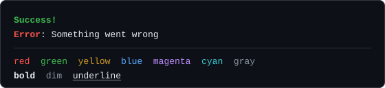

# Color

`color` applies terminal colors and text styles to strings, `c` does the same inside a template literal, and a group of string utilities measures, trims, and sanitizes text that already contains escape sequences. All of them are plain functions exported from the package: none of them needs a `CLI` instance, and they can be imported into any Node script.



## A first example

```ts
import { c, color } from "@libraz/node-cli";

console.log(color.bold.green("Success!"));
console.log(c`{bold.red Error}: Something went wrong`);

console.log(
  [
    color.red("red"),
    color.green("green"),
    color.yellow("yellow"),
    color.blue("blue"),
    color.magenta("magenta"),
    color.cyan("cyan"),
    color.gray("gray"),
  ].join("  "),
);

console.log([color.bold("bold"), color.dim("dim"), color.underline("underline")].join("  "));
```

Each style function takes a string and returns a string. Nothing is printed until the result is passed to `console.log` or written to a stream.

### What a style function actually returns

A terminal renders colors when it receives an **ANSI escape sequence**: a short run of invisible control characters that tells the terminal "start drawing in green" and, later, "stop". `color.green("ok")` returns the text with those two markers wrapped around it. The markers occupy no columns on screen, but they are real characters in the string, which is why `"ok".length` and the length of the colored string differ. Use [`stringWidth`](#stringwidthtext-number) rather than `.length` whenever the number matters.

## Chaining styles

`color` is a proxy object: every style name is a property, and every property is itself a function that also carries the remaining style names as properties. Chaining reads left to right and applies all the named styles at once.

```ts
import { color } from "@libraz/node-cli";

console.log(color.bold.underline("Title"));
console.log(color.bgYellow.black("  WARNING  "));
```

Accessing a name that is not a style throws `Error: Unknown style: <name>`, so a typo fails loudly instead of silently returning plain text. The properties `then`, `toString`, `valueOf`, `toJSON`, `constructor`, and any symbol pass through untouched, so awaiting, stringifying, or serializing a colorizer does not throw.

## The complete style list

These are all the styles the package supports. There are no bright variants, no 256-color palette, and no hex or RGB API.

| Group | Names |
| --- | --- |
| Modifiers | `bold`, `dim`, `italic`, `underline`, `inverse`, `strikethrough` |
| Foreground | `black`, `red`, `green`, `yellow`, `blue`, `magenta`, `cyan`, `white`, `gray`, `grey` |
| Background | `bgRed`, `bgGreen`, `bgYellow`, `bgBlue`, `bgMagenta`, `bgCyan`, `bgWhite` |

`grey` is an alias of `gray`. There is no `bgBlack`.

## Nesting

Styles nest safely. Each layer re-opens itself after any escape sequence an inner layer closed, so text after a nested fragment keeps the outer style:

```ts
import { color } from "@libraz/node-cli";

console.log(color.red(`a ${color.green("b")} c`));
// "a" and "c" stay red; only "b" is green
```

## Inline markup with the `c` tag

`c` is a tagged template literal: it is written directly before a backtick string and transforms that string. It renders `{style content}` markup instead of nesting function calls.

```ts
import { c } from "@libraz/node-cli";

const port = 3000;

console.log(c`Status: {green OK}`);
console.log(c`{bold.red Error}: broken`);
console.log(c`Listening on {cyan http://localhost:${port}}`);
console.log(c`{yellow outer {bold inner} outer}`);
```

The syntax is strict:

- an opening `{`,
- a style name, or several joined by dots,
- **exactly one space**,
- the content, up to the matching `}`.

Braces are counted, so markup can be nested.

When the style name is unknown, the space is missing, or a brace is unbalanced, the `{` is emitted **literally** and the rest of the text is left alone. Unlike `color.foo`, `c` never throws on bad markup. The one exception is depth: markup nested more than 64 levels deep throws.

Interpolated values are converted to strings and substituted **after** the markup has been rendered. A `{` inside an interpolated value is therefore never parsed as markup, so untrusted data cannot inject styling.

## When color is enabled

Enablement is decided **at the moment a style function is called**, not when the module is imported. `color` and `c` evaluate it against `process.stdout`. `createColorizer(stream)` returns the same chainable object bound to a different stream:

```ts
import { createColorizer } from "@libraz/node-cli";

const errColor = createColorizer(process.stderr);
console.error(errColor.red("failed"));
```

`isColorEnabled(stream?)` answers the question directly, defaulting to `process.stdout`. It resolves in this order, stopping at the first rule that applies:

1. An explicit `setColorEnabled(true)` / `setColorEnabled(false)` override. This wins over everything, including `NO_COLOR`.
2. `NO_COLOR` set to a non-empty value: color off.
3. `FORCE_COLOR` set to a non-empty value: `"0"` or `"false"` turns color off, any other value turns it on. This beats `TERM=dumb` and beats a stream that is not a terminal.
4. `TERM` equal to `"dumb"`: color off.
5. Otherwise, whether the stream is a **terminal** — an interactive console, as opposed to a file or a pipe into another program.

```ts
import { isColorEnabled, resetColorEnabled, setColorEnabled } from "@libraz/node-cli";

setColorEnabled(false); // force plain text, e.g. inside a test
isColorEnabled(); // false
resetColorEnabled(); // drop the override, return to automatic detection
```

`setColorEnabled` sets a single module-wide flag. It is not per stream: once set, every colorizer follows it until `resetColorEnabled()` clears it.

## String utilities

These functions exist because a string that contains escape sequences cannot be measured or cut with the ordinary string methods. `"\x1b[31mred\x1b[39m".length` is 14, `"日本".length` is 2 but occupies four terminal columns, and slicing either one can cut an escape sequence or a character in half.

### `stringWidth(text): number`

Returns how many terminal columns the text occupies. Escape sequences are stripped first, then the text is split into **graphemes** — the units a reader perceives as single characters, which may be built from several code points, such as an emoji with a skin-tone modifier.

- Combining marks and zero-width joiners count 0.
- East Asian wide characters and emoji count 2.
- A grapheme carrying U+FE0F (emoji presentation) or U+20E3 (keycap) counts 2.

Grapheme segmentation uses `Intl.Segmenter`, so a joined emoji sequence such as a family emoji is one 2-column cell rather than the sum of its parts. This is the measurement [tables](table.md) use, and it is why columns line up when cells contain Japanese text.

```ts
import { stringWidth } from "@libraz/node-cli";

stringWidth("abc"); // 3
stringWidth("日本語"); // 6
stringWidth("\x1b[31mred\x1b[39m"); // 3
```

### `stripAnsi(text): string`

Removes every ANSI escape sequence, both CSI sequences (colors, cursor movement, screen erasing) and OSC sequences (window titles, hyperlinks). Use it before writing terminal output to a log file.

### `truncateAnsi(text, maxWidth, marker = "…"): string`

Shortens text to at most `maxWidth` display columns, appending `marker`. It never splits a grapheme in half, it fits the marker to the available width as well, it keeps the escape sequences that were inside the retained part, and it appends whatever escapes are needed to close any style the cut left open. A `maxWidth` of `0` or less returns `""`.

```ts
import { truncateAnsi } from "@libraz/node-cli";

truncateAnsi("a very long line", 8); // "a very …"
```

### `splitAnsi(text): AnsiSegment[]`

Splits the text into ordered runs, each `{ ansi: boolean; text: string }`. Segments with `ansi: true` are escape sequences; the rest is visible text. Concatenating every `.text` reproduces the input exactly, so this is the building block for transforming visible text while leaving escapes intact.

### `splitGraphemes(text): string[]`

Splits text into grapheme clusters.

### `sanitizeTerminalText(text, options?): string`

Makes an untrusted string safe to print. Options are `{ singleLine = true, allowHyperlinks = true }`.

- Color and style sequences are kept.
- OSC 8 hyperlinks are kept unless `allowHyperlinks: false`.
- **Every other escape sequence is dropped**: cursor movement, screen erasing, window-title changes, scroll-region changes.
- In single-line mode newlines become spaces; with `singleLine: false` newlines survive.
- Tabs, vertical tabs, form feeds, and carriage returns each become one space.
- All other control bytes are dropped.

This matters because a terminal executes whatever escape sequences reach it. A string taken from a file name, an HTTP response, or a database row can otherwise erase the screen, move the cursor over previously printed output, or rewrite the window title. Passing it through `sanitizeTerminalText` first removes that ability while keeping the colors intact. Table cells and progress labels already go through it.

```ts
import { sanitizeTerminalText } from "@libraz/node-cli";

const fromDatabase = "release \x1b[2J\x1b[Hv2";
console.log(sanitizeTerminalText(fromDatabase)); // "release v2" — the screen is not cleared
```

### `streamIsTTY(stream): boolean`

Reports whether a stream is a terminal rather than a file or a pipe.

## Common surprises

- **Enablement is evaluated per call.** Setting `FORCE_COLOR` after the module was imported still takes effect, and `setColorEnabled` applies to calls made afterwards.
- **`setColorEnabled` is global, not per stream.** A colorizer built with `createColorizer` still obeys it.
- **`color.foo` throws; `c` does not.** An unknown style name is a hard error on the proxy and a literal `{` in inline markup.
- **A missing space breaks inline markup silently.** `` c`{green OK}` `` colors `OK`; `` c`{greenOK}` `` prints `{greenOK}`.
- **`.length` is not width.** Escape sequences add length, and wide characters add width; use `stringWidth`.
- **There is no `bgBlack` and no bright or RGB colors.** The list above is complete.

## Related pages

- [Table](table.md) — uses the same width measurement to align columns.
- [Logging](logging.md) — colorizes its icons per stream.
- [Progress](progress.md) — accepts a style name for bars and spinners.
- [Glossary](glossary.md) — terminal, escape sequence, grapheme.
