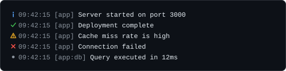

# Logging

`createLogger(options?)` creates a leveled logger: five methods that write a formatted line with an icon, an optional timestamp, and an optional prefix. It is a plain function exported from the package, so it needs no `CLI` instance and can be imported into any Node script.



## A first example

```ts
import { createLogger } from "@libraz/node-cli";

const log = createLogger({ prefix: "app", timestamp: true, level: "debug" });

log.info("Server started on port %d", 3000);
log.success("Deployment complete");
log.warn("Cache miss rate is high");
log.error("Connection failed");

const db = log.child("db");
db.debug("Query executed in 12ms");
```

## Where the output goes

**Every level writes to one stream, and that stream defaults to `process.stderr`.** There is no split by severity: `info` and `success` go to stderr exactly like `warn` and `error` do.

The reason is that stdout is the channel a command's *data* travels on. A user who runs `mycli list --json > out.json` expects `out.json` to contain JSON and nothing else; diagnostics on stdout would corrupt it. Keeping all diagnostics on stderr means they stay visible on the terminal while the redirected file stays clean.

To send log output to stdout instead, pass that stream as `stderr`; the option has the name of the role it plays by default. A command context works as the options, so `createLogger(ctx)` logs to the command's `stderr`.

```ts
import { createLogger } from "@libraz/node-cli";

const log = createLogger({ stderr: process.stdout });
```

## Options

`LoggerOptions`:

| Field | Type | Default | Behavior |
| --- | --- | --- | --- |
| `level` | `LogLevel` | `"info"` | Minimum level that is emitted. A string that is not a `LogLevel` throws a `RangeError` with `code: "ERR_INVALID_ARG_VALUE"`; a non-string throws a `TypeError` with `code: "ERR_INVALID_ARG_TYPE"`. `setLevel` validates the same way. |
| `prefix` | `string` | — | Rendered as `[prefix]` before the message. |
| `timestamp` | `boolean` | `false` | Adds the local time as `HH:MM:SS`. |
| `stderr` | `Writable` | `process.stderr` | Destination for every level. |
| `bufferLimit` | `number` | `1000` | Lines queued while the stream is busy. When the queue is full the oldest line is dropped; `0` drops every line written while the stream is busy, until it drains. Must be a non-negative safe integer: a non-number throws a `TypeError` (`ERR_INVALID_ARG_TYPE`), any other invalid number a `RangeError` (`ERR_INVALID_ARG_VALUE`). |

A `prefix`, `timestamp` or `stderr` of the wrong type throws a `TypeError` with `code: "ERR_INVALID_ARG_TYPE"`.

## Levels

```ts
type LogLevel = "debug" | "info" | "warn" | "error" | "silent";
```

`isLogLevel(value)` is a type guard that reports whether an `unknown` value is one of these five strings.

They are ordered `debug < info < warn < error < silent`. A message is emitted when its own level is at or above the configured level, so `level: "warn"` shows warnings and errors and drops everything below. `level: "silent"` suppresses all output.

## Methods

`Logger`:

| Method | Signature |
| --- | --- |
| `debug` | `(message: unknown, ...args: unknown[]) => void` |
| `info` | `(message: unknown, ...args: unknown[]) => void` |
| `success` | `(message: unknown, ...args: unknown[]) => void` |
| `warn` | `(message: unknown, ...args: unknown[]) => void` |
| `error` | `(message: unknown, ...args: unknown[]) => void` |
| `setLevel` | `(level: LogLevel) => this` |
| `child` | `(prefix: string) => Logger` |
| `flush` | `() => Promise<void>` |

`setLevel` returns the logger itself, so calls chain: `log.setLevel("debug").info("verbose on")`. Calling it again replaces the level.

`success` is not a separate level. It is gated at the **`info`** level and rendered with the `✔` marker (or `[OK]`, see below), so it disappears together with `info` when the level is raised to `warn`.

## Formatting

Every call goes through Node's `util.format`, whether or not extra arguments were supplied. Two consequences follow.

Format specifiers work:

```ts
import { createLogger } from "@libraz/node-cli";

const log = createLogger();

log.info("Listening on %s:%d", "127.0.0.1", 3000);
log.info("Config: %o", { retries: 3 });
log.info("Payload: %j", { ok: true });
```

`%s` inserts a string, `%d` a number, `%j` JSON, and `%o` an inspected object.

The same routing means a non-string first argument is inspected rather than crashing the call. The declared parameter type is `unknown`, so an `Error` or an object can be passed directly: `util.format` renders it (message and stack for an error, an inspected view for an object) instead of throwing inside the logging call.

Message text is then sanitized (and a value whose own formatting throws, such as a throwing `toString`, is printed as `[unprintable]` rather than failing the call): **newlines are kept**, so a multi-line stack trace renders across several lines; tabs and carriage returns become single spaces; all other control bytes are dropped. This prevents a message taken from untrusted input from moving the cursor or erasing the screen. Styling or a hyperlink the message leaves open is closed at the end of the message, before the newline.

## Line layout

A line is assembled from four parts joined by a single space, with the optional ones omitted when unset:

`icon`, `timestamp`, `[prefix]`, `message`. The timestamp is printed bare; only the prefix is wrapped in square brackets:

```text
ℹ 09:42:15 [app] Server started on port 3000
```

The icon and its color are decided independently:

- The icon is a symbol when the stream is a terminal and `TERM` is not `dumb`; otherwise it is an ASCII tag.
- The color is applied to the icon whenever color is enabled for the stream. See [Color](color.md) for how that is decided.

| Level | Symbol | ASCII tag | Color |
| --- | --- | --- | --- |
| `debug` | `●` | `[DEBUG]` | dim |
| `info` | `ℹ` | `[INFO]` | blue |
| `success` | `✔` | `[OK]` | green |
| `warn` | `⚠` | `[WARN]` | yellow |
| `error` | `✖` | `[ERROR]` | red |

| Stream | Color | Icon |
| --- | --- | --- |
| Terminal | enabled | colored symbol |
| Terminal | disabled (`NO_COLOR`) | plain symbol |
| Not a terminal | forced (`FORCE_COLOR`) | colored ASCII tag |
| Not a terminal | disabled | plain ASCII tag |

Redirecting output to a file therefore produces plain, greppable `[WARN]`-style labels with no escape sequences in them. The timestamp and the `[prefix]` are dimmed whenever color is enabled. [Progress](progress.md) result lines follow the same rule.

## Child loggers

`child(prefix)` returns a logger scoped to a subsystem. Prefixes compose with `:`.

```ts
import { createLogger } from "@libraz/node-cli";

const log = createLogger({ prefix: "app" });
const db = log.child("db"); // prefix "app:db"
const pool = db.child("pool"); // prefix "app:db:pool"
```

A child inherits `timestamp`, `stderr`, and `bufferLimit` from its parent, and shares the stream's write queue with it: lines from a parent and its children reach the stream in call order. The level is inherited **dynamically**: a later `parent.setLevel("debug")` reaches every child that never set a level of its own, while `child.setLevel(...)` overrides that one child and nothing else.

```ts
import { createLogger } from "@libraz/node-cli";

const log = createLogger({ prefix: "app" });
const db = log.child("db");

log.setLevel("debug"); // db now logs debug too
db.setLevel("error"); // db logs only errors; log is unaffected
log.setLevel("info"); // db keeps its own "error"
```

## Interaction with progress indicators

A log line written to a stream that a bar or spinner is currently drawing on does not land in the middle of the frame. The indicator steps aside, the line is written on a clean row, and the indicator redraws itself below. See [Progress](progress.md).

This cooperation only applies to output written through the logger. A raw `stream.write` bypasses it and will corrupt a drawn frame.

## Backpressure and `flush`

A stream can accept only so much at once; when it is full, further writes have to wait. That waiting state is **backpressure**. While it lasts, the logger queues lines in memory up to `bufferLimit` and, once the queue is full, discards the **oldest** line to make room for the newest. With `bufferLimit: 0` a line arriving during backpressure is dropped immediately.

If the stream emits an error or closes at any time, the buffered lines are discarded and every pending and later `flush()` rejects with that failure. From then on the logger and all of its children are no-ops: later lines are dropped silently, and the failure is not reported again. The logger keeps its own `error` listener on the stream, so the failure does not crash the process.

`flush()` resolves once the buffered lines have reached the stream and the stream has accepted every earlier write. Parent and children share one queue per stream, so one call covers the whole tree.

```ts
import { createLogger } from "@libraz/node-cli";

const log = createLogger();

log.info("done");
await log.flush();
process.exit(0);
```

Awaiting `flush()` before exiting is what keeps the last lines from being lost when the process ends while a write is still in flight.

## Common surprises

- **The default stream is stderr, for every level.** `mycli run > out.txt` still shows the log on the terminal; `2> log.txt` is what captures it.
- **There is no stdout/stderr split by severity.** Pass `stderr: process.stdout` to move everything to stdout.
- **`success` is gated at `info`.** Raising the level to `warn` hides it.
- **`success` is not a `LogLevel`.** It cannot be passed to `setLevel`.
- **A child's level tracks its parent until the child sets its own**, after which the parent no longer affects it.
- **Icons follow the terminal, color follows the color policy.** A stream that is not a terminal gets `[INFO]`, not `ℹ`, whether or not it is colored.
- **Newlines survive, tabs do not.** Stack traces stay multi-line; tabs become spaces.
- **Lines can be dropped under backpressure.** The oldest go first; `flush()` reports failures.
- **A failed stream silences the logger.** After the stream errors or closes, every later line is dropped.

## Related pages

- [Color](color.md) — how color enablement per stream is decided.
- [Progress](progress.md) — indicators that share a stream with the logger.
- [Commands](commands.md) — the streams available on a command context.
- [Errors](errors.md) — reporting failures and exit codes.
