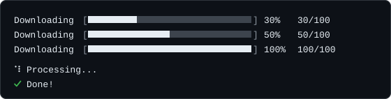

# Progress

`progress` creates the indicators that show a long-running operation is still moving: a progress bar with a known total, a spinner for work of unknown length, and a multi-bar group for several concurrent tasks. Every factory is a plain function exported from the package, so none of them needs a `CLI` instance.



## A first example

```ts
import { progress } from "@libraz/node-cli";

const wait = (ms: number) => new Promise((resolve) => setTimeout(resolve, ms));

const bar = progress.bar({ total: 100, label: "Downloading" });
for (let done = 0; done <= 100; done += 10) {
  bar.update(done);
  await wait(100);
}
bar.succeed("Downloaded");

const spinner = progress.spinner({ label: "Processing..." });
await wait(1000);
spinner.succeed("Done!");
```

Both indicators start drawing as soon as they are created, and redraw in place. A line wider than the terminal wraps, and every redraw, log line and result erases all of the rows it occupied. Both write to **`process.stderr`** by default, which keeps `process.stdout` free for data another program might be reading. The stream option is named `stderr`, like the command context member, so a context can be passed as the options: `progress.spinner({ ...ctx, label })`.

## What the object contains

`progress` has four members: `bar`, `spinner`, `multi`, and `releaseAll`. `releaseAll` is a member of `progress` only; it and the cursor helper behind it are not exported from the package root.

## Terminal verbs

A bar, a spinner and a multi-bar group all end with the same four verbs, and every one returns `void`:

| Verb | Behavior on a terminal | Behavior without a terminal |
| --- | --- | --- |
| `succeed(message?)` | Replaces the frame with a green `✔` and `message ?? label`. A bar first advances to `total`. | Writes that one line with `[OK]`. |
| `fail(message?)` | Replaces the frame with a red `✖` and `message ?? label`. A bar stops where it is. | Writes that one line with `[ERROR]`. |
| `warn(message?)` | Replaces the frame with a yellow `⚠` and `message ?? label`. A bar stops where it is. | Writes that one line with `[WARN]`. |
| `stop()` | Leaves the last frame in place and ends the line. | Writes nothing. |

Once a verb has run, the handle is finished: later calls on it do nothing. `[Symbol.dispose]()` is the same as `stop()`.

The symbol and the color of a result line are decided independently:

- The symbol is `✔`, `✖` or `⚠` when the stream is a terminal and `TERM` is not `dumb`; otherwise it is the ASCII tag `[OK]`, `[ERROR]` or `[WARN]`.
- The color (green, red, yellow) is applied to the symbol or tag whenever color is enabled for the stream, as described in [Color](color.md).

| Stream | Color | Result line |
| --- | --- | --- |
| Terminal | enabled | colored symbol |
| Terminal | disabled (`NO_COLOR`) | plain symbol |
| Not a terminal | forced (`FORCE_COLOR`) | colored ASCII tag |
| Not a terminal | disabled | plain ASCII tag |

[Logging](logging.md) uses the same rule for `log.success`, `log.error` and `log.warn`.

## `progress.bar(options)`

Creates a bar for work whose total is known. On a terminal the bar claims its stream and draws 0% before `bar()` returns.

### `BarOptions`

| Field | Type | Default | Behavior |
| --- | --- | --- | --- |
| `total` | `number` | required | Total number of units. Must be a finite number of at least `0`; a total of `0` renders as 100%. A non-number throws `TypeError`, any other value `RangeError`. |
| `label` | `string` | `""` | Text before the bar. Omitted from the line when empty. |
| `width` | `number` | `30` | Bar width in characters. A fractional value is floored, to at least one cell. A non-finite value, one `<= 0`, or one above `4096` throws `RangeError`; a non-number throws `TypeError`. |
| `filled` | `string` | `"█"` | Glyph for the completed portion. Its display width must be 1, otherwise `RangeError`. |
| `empty` | `string` | `"░"` | Glyph for the remaining portion. Its display width must be 1, otherwise `RangeError`. |
| `format` | `(state: BarState) => string` | — | Replaces the whole rendered line, so `width`, `filled`, `empty` and `style` do not apply to it; `label` still supplies the default result message. The returned text is reduced to one terminal-safe line. If it throws, the bar releases the terminal, becomes inert, and the error propagates from the call that triggered the redraw. |
| `stderr` | `Writable` | `process.stderr` | Where the bar is drawn. |
| `style` | `StyleSpec` | — | A style name or a dot-separated chain such as `"bold.cyan"`, applied to the bar glyphs. An unknown name throws `RangeError` when the bar is created. |

The default line is `` `${label}  [${bar}]  ${percent}%  ${current}/${total}` ``, with the label dropped when it is empty.

### `BarState`

Passed to `format` on every redraw. Every member is `readonly`.

| Field | Meaning |
| --- | --- |
| `current` | Units completed. |
| `total` | The total. |
| `percent` | Integer percentage from 0 to 100; `100` when `total` is `0`. |
| `elapsedMs` | Milliseconds since the bar was created. |
| `etaMs` | Estimated milliseconds remaining. `Infinity` until some progress has been made, `0` once complete. |
| `ratePerSecond` | Units per second. |

```ts
import { progress } from "@libraz/node-cli";

const bar = progress.bar({
  total: 100,
  format: (state) =>
    Number.isFinite(state.etaMs)
      ? `${state.percent}% - ${Math.round(state.etaMs / 1000)}s left`
      : `${state.percent}%`,
});
```

### `Bar`

| Method | Behavior |
| --- | --- |
| `update(current)` | Sets the absolute progress value. |
| `tick(delta = 1)` | Advances the value by `delta`. |
| `setLabel(label)` | Replaces the label drawn before the bar and used as the default result message. |
| `succeed(message?)`, `fail(message?)`, `warn(message?)`, `stop()` | The [terminal verbs](#terminal-verbs). |
| `[Symbol.dispose]()` | Identical to `stop()`. |

`NaN` and infinite values passed to `update` or `tick` are ignored, a non-number throws `TypeError`, and every value is clamped to the range `[0, total]`. `update` and `tick` are no-ops without a terminal. In a multi-bar group, `stop()` on a bar freezes that bar's row; the group's verbs then skip it.

## `progress.spinner(options?)`

Creates an animated indicator for work whose duration is unknown. On a terminal the spinner claims its stream and starts animating before `spinner()` returns.

### `SpinnerOptions`

| Field | Type | Default | Behavior |
| --- | --- | --- | --- |
| `label` | `string` | `""` | Text beside the animation. |
| `frames` | `readonly string[]` | `["⠋","⠙","⠹","⠸","⠼","⠴","⠦","⠧","⠇","⠏"]` | Animation frames, each drawn whole at any width. An empty array throws `RangeError`; anything that is not an array of strings throws `TypeError`. |
| `intervalMs` | `number` | `80` | Milliseconds between frames. A finite number above `0`; fractions are allowed. Anything else throws `RangeError` (`TypeError` for a non-number). |
| `stderr` | `Writable` | `process.stderr` | Where the spinner is drawn. |
| `style` | `StyleSpec` | — | A style name or chain applied to the frame glyph. An unknown name throws `RangeError` when the spinner is created. |

The default frame set is the braille dots shown above. Two other sets exist in the source but are not exported; pass them explicitly to use them:

```ts
import { progress } from "@libraz/node-cli";

const lineSpinner = progress.spinner({ label: "Working", frames: ["-", "\\", "|", "/"] });
const arrowSpinner = progress.spinner({
  label: "Working",
  frames: ["←", "↖", "↑", "↗", "→", "↘", "↓", "↙"],
});
```

### `Spinner`

| Method | Behavior |
| --- | --- |
| `setLabel(label)` | Replaces the label; the next frame shows it. Calling it again replaces the label again. |
| `succeed(message?)`, `fail(message?)`, `warn(message?)`, `stop()` | The [terminal verbs](#terminal-verbs). |
| `[Symbol.dispose]()` | Identical to `stop()`. |

The animation timer does not keep the Node process alive on its own, so a program that finishes its work exits normally even if a spinner was left running.

## `progress.multi(options?)`

Creates a group that draws several bars as one block. `options.stderr` names the stream shared by every bar in the group; it defaults to `process.stderr`. On a terminal the group claims that stream when it is created.

```ts
import { progress } from "@libraz/node-cli";

const group = progress.multi();
const download = group.add({ total: 100, label: "download" });
const extract = group.add({ total: 100, label: "extract " });

download.update(60);
extract.update(25);

group.succeed("All done");
```

| Member | Behavior |
| --- | --- |
| `add(options)` | Adds a bar, draws it at 0%, and returns a `Bar` handle. `options` is `BarOptions` without `stderr`. |
| `succeed(message?)`, `fail(message?)`, `warn(message?)`, `stop()` | The [terminal verbs](#terminal-verbs), applied as described below. |
| `[Symbol.dispose]()` | Identical to `stop()`. |

A bar inside a group takes the same verbs as a standalone bar. When it ends, only its own row becomes a result row and the rest of the group keeps drawing. A group verb applies that same verb to every bar that has not ended, then closes the group. When `message` is given it is written as one final line with no marker. Without a terminal, each bar's result row is written as soon as the bar ends, followed by the message line.

Calling `add()` after the group has closed returns an inert handle whose methods all do nothing, rather than throwing, so a worker that registers a bar just after the group closed does not fail the command.

## Automatic cleanup with `using`

`using` is a JavaScript declaration that runs a cleanup step when the enclosing block is left, whichever way it is left: a normal return, an early `return`, or a thrown error. A value is eligible when it has a `[Symbol.dispose]()` method, which bars, spinners, and multi-bar groups all do. It requires a runtime and TypeScript configuration with explicit resource management enabled.

```ts
import { copyFileSync } from "node:fs";
import { progress } from "@libraz/node-cli";

function copyAll(files: readonly string[], target: string): void {
  using bar = progress.bar({ total: files.length, label: "Copying" });
  for (const file of files) {
    copyFileSync(file, `${target}/${file}`);
    bar.tick();
  }
}
```

The exact equivalent without `using`:

```ts
import { copyFileSync } from "node:fs";
import { progress } from "@libraz/node-cli";

function copyAll(files: readonly string[], target: string): void {
  const bar = progress.bar({ total: files.length, label: "Copying" });
  try {
    for (const file of files) {
      copyFileSync(file, `${target}/${file}`);
      bar.tick();
    }
  } finally {
    bar.stop();
  }
}
```

Either form guarantees the line is closed and the cursor restored even when the copy throws.

## Behavior without a terminal

This is the most common source of confusion. When the target stream is not a **terminal** — for example when output is redirected to a file, piped into another program, or captured by a CI runner — the indicators draw no frames:

- **Frames are never written.** A bar or spinner that ends with `stop()` leaves nothing in the log.
- **`TERM=dumb` counts as no terminal** for drawing: it cannot move the cursor, so the indicators behave as they do on a stream that is not a terminal.
- **`succeed`, `fail` and `warn` always write their one result line**, bars and multi-bar groups included, so the outcome of a run stays in a CI log. They are the way to leave a permanent record.
- **The cursor is only hidden and restored on a terminal.**

On a stream that cannot animate, the result line uses the ASCII tags from the table above.

To keep a readable log in both settings, report milestones through [`logger`](logging.md) and let the bar handle the interactive case.

## Cleanup and cursor restoration

A bar or spinner hides the terminal cursor while it draws, and shows it again when it ends.

Indicators created while a command runs are scoped to that command: when the command ends, successfully or not, the framework stops the ones it created and nothing else. An indicator started by a concurrent command keeps running. The same applies to a mode action in the interactive shell.

`progress.releaseAll()` is the explicit process-wide reset. It stops every indicator that is still active, whoever created it, and restores the cursor on every stream where it is hidden. It is safe to call repeatedly, and the interactive shell's crash handlers call it. A `process.exit` handler also restores the cursor on an abrupt exit.

## Other behavior

- **One standalone indicator per stream.** Creating a second bar, spinner or multi-bar group on the same terminal stream throws an `Error` with code `ERR_OUTPUT_BUSY`, at creation. The message names the kind of indicator that holds the stream and asks for it to be finished with `succeed()`, `fail()`, `warn()` or `stop()`; only when both are bars does it also point to `progress.multi()` for concurrent bars. Two indicators cannot infer each other's row layout. On a non-terminal stream nothing is drawn, so the guard does not fire.
- **Progress and log output interleave cleanly.** A [`logger`](logging.md) writing to the same stream steps around the drawn frame and the indicator redraws itself afterwards, because both cooperate through a shared arbiter. A raw `stream.write` does not, and will land in the middle of a half-drawn frame.

## Common surprises

- **The default stream is `process.stderr`, not `process.stdout`.** Redirecting stdout to a file does not silence a bar; redirecting stderr does.
- **Indicators start when created.** An indicator you create and never end holds its stream; end it with a verb, or declare it with `using`.
- **`stop()` keeps the last frame.** To replace it with a result line, use `succeed`, `fail` or `warn`.
- **A bar draws nothing without a terminal until a verb runs**, and then only the one result line.
- **`etaMs` is milliseconds**, not seconds, and is `Infinity` until progress has actually been made. Check it with `Number.isFinite` before formatting.
- **`width` of `0` throws**, while a `total` of `0` does not — it renders as an immediately complete bar.

## Related pages

- [Logging](logging.md) — leveled output that coexists with a running indicator.
- [Color](color.md) — the style names accepted by `style`.
- [Commands](commands.md) — the command context whose `stderr` the indicators draw on.
- [Errors](errors.md) — behavior on cancellation and crashes.
