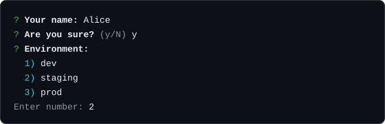

# Prompts

`prompt` asks the person at the keyboard a question and resolves with the answer: free text, a yes/no confirmation, a single choice, several choices, or a masked password. Every method is a plain async function exported from the package, so none of them needs a `CLI` instance.



## A first example

```ts
import { prompt } from "@libraz/node-cli";

const name = await prompt.text("Your name:");
const sure = await prompt.confirm("Are you sure?");
const env = await prompt.select("Environment:", ["dev", "staging", "prod"]);

console.log(name, sure, env);
```

Each call reads one answer, re-asking until the input is acceptable. Questions are written to `process.stdout` and read from `process.stdin` by default.

## What the object contains

`prompt` has five members: `text`, `confirm`, `select`, `multiselect`, and `password`. `maskInput` is a separate top-level export.

```ts
import { maskInput, prompt } from "@libraz/node-cli";
```

## Shared options

Every method accepts these, through `PromptBaseOptions<T>`:

| Field | Type | Default | Behavior |
| --- | --- | --- | --- |
| `validate` | `(value: T) => void` | — | Throw inside it to reject the value. |
| `required` | `boolean` | see each method | Whether an empty submission is rejected. |
| `prefix` | `string` | `"?"` | Symbol before the question. |
| `stdout` | `Writable` | `process.stdout` | Where the question is written. |
| `stdin` | `Readable` | `process.stdin` | Where the answer is read from. |
| `signal` | `AbortSignal` | — | Cancels a pending prompt when aborted. |

### `validate` does not reject the promise

Throwing inside `validate` prints the error message below the question and asks again. The returned promise stays pending until an accepted value arrives. Only cancellation escapes the loop.

```ts
import { prompt } from "@libraz/node-cli";

const port = await prompt.text("Port:", {
  validate: (value) => {
    const n = Number(value);
    if (!Number.isInteger(n) || n < 1 || n > 65535) {
      throw new Error("Enter a port between 1 and 65535");
    }
  },
});
```

## `prompt.text(message, options?)`

Returns `Promise<string>`.

| Field | Default | Behavior |
| --- | --- | --- |
| `default` | — | Value used when the submission is empty. |
| `placeholder` | — | Hint text, shown only when there is no `default`. |
| `trim` | `true` | Strips leading and trailing whitespace from the answer. |
| `required` | `true` | An empty submission is rejected and the question repeats. |

An explicit `default` — **including an empty string** — fills an empty submission and **bypasses** the required check. Supplying `default: ""` is therefore how to accept an empty answer while leaving `required` alone.

```ts
import { prompt } from "@libraz/node-cli";

const branch = await prompt.text("Branch:", { default: "main" });
const note = await prompt.text("Note:", { default: "" }); // may come back empty
const email = await prompt.text("Email:", { placeholder: "you@example.com" });
```

## `prompt.confirm(message, options?)`

Returns `Promise<boolean>`. The only extra option is `default`, which defaults to `false`.

The hint shown after the question is `(Y/n)` when the default is `true` and `(y/N)` when it is `false`. Accepted answers are an empty submission (which takes the default) and `y`, `yes`, `n`, `no`, matched case-insensitively. Anything else prints a message and asks again.

```ts
import { prompt } from "@libraz/node-cli";

if (await prompt.confirm("Delete all local branches?", { default: false })) {
  console.log("deleting");
}
```

## `prompt.select(message, choices, options?)`

Returns `Promise<T>`. An empty `choices` array throws.

The choices are printed as a numbered list. Input is either a **1-based number** or a case-insensitive match on a choice label; pressing Enter with no input picks the default, when one is configured. Duplicate labels print a warning and resolve to the first occurrence, so number entry is the way to reach a later one.

```ts
import { prompt } from "@libraz/node-cli";

const env = await prompt.select("Environment:", ["dev", "staging", "prod"], {
  default: "staging",
});
```

## `prompt.multiselect(message, choices, options?)`

Returns `Promise<T[]>`.

| Field | Behavior |
| --- | --- |
| `default` | `T[]` of pre-selected values. |
| `min` | Minimum number of items. |
| `max` | Maximum number of items. |

`min` and `max` must be non-negative safe integers, `min` must not exceed `max`, and `min` must not exceed the number of choices; any violation throws `RangeError` before the question is asked.

Input is comma-separated 1-based numbers. Repeated numbers are **deduplicated before** `min` and `max` are counted, so `1,1,2` counts as two selections. An empty submission uses the defaults.

```ts
import { prompt } from "@libraz/node-cli";

const features = await prompt.multiselect("Enable:", ["auth", "cache", "metrics"], {
  default: ["auth"],
  min: 1,
});
```

## `prompt.password(message, options?)`

Returns `Promise<string>`. Typed characters are echoed as asterisks.

| Field | Default | Behavior |
| --- | --- | --- |
| `trim` | `false` | Unlike `text`, whitespace is kept — it may be part of the secret. |
| `required` | `true` | An empty submission is rejected. |
| `stderr` | `process.stderr` | Where the question goes when input is a terminal but `stdout` is redirected. |

There is **no `default` field** on a password prompt.

When input is a terminal but output has been redirected, the question and the masked echo are written to stderr instead of stdout, so a captured stdout never receives any part of the interaction.

```ts
import { prompt } from "@libraz/node-cli";

const token = await prompt.password("API token:");
```

## Choices

```ts
type SelectChoice<T> = { label: string; value: T; hint?: string };
type Choice<T> = T | SelectChoice<T>;
```

A choice is either a bare value — whose string form becomes the label — or a descriptor object.

```ts
import { prompt } from "@libraz/node-cli";

const region = await prompt.select("Region:", [
  { label: "Tokyo", value: "ap-northeast-1", hint: "closest" },
  { label: "Frankfurt", value: "eu-central-1" },
]);
```

An object that has a `label` but no `value` throws `TypeError`, so an ordinary domain object is never silently turned into `undefined`.

`hint` is rendered by `select` only. `multiselect` ignores it.

Default matching uses `Object.is` against either the choice's `value` or the choice object itself. It is **not** structural equality: a default written as a fresh object literal will not match an equal-looking choice. Match on a primitive value, or pass the same object reference.

## Cancellation

Prompts throw `PromptCancelError` — code `PROMPT_CANCELLED`, exit code `130` — rather than resolving, in every one of these situations:

- Ctrl+C is pressed;
- Ctrl+D is pressed, or input otherwise reaches its end;
- the input stream had already ended before the prompt started;
- a supplied `signal` aborts, including a signal that was already aborted.

Detect it with `isCancellationError`:

```ts
import { isCancellationError, prompt } from "@libraz/node-cli";

try {
  const name = await prompt.text("Your name:");
  console.log(`Hello, ${name}`);
} catch (err) {
  if (isCancellationError(err)) {
    console.error("Cancelled.");
    process.exitCode = 130;
  } else {
    throw err;
  }
}
```

An `AbortSignal` gives a prompt a deadline or an external cancel button:

```ts
import { prompt } from "@libraz/node-cli";

const answer = await prompt.text("Quick — a word:", {
  signal: AbortSignal.timeout(5000),
});
```

See [Errors](errors.md) for how a CLI handles the error when it is not caught.

## `maskInput(chunk)`

Transforms a chunk of terminal output the way the password prompt does: ANSI escape sequences and line breaks pass through unchanged, and every other run of visible text is replaced with **one `*` per grapheme** — per user-perceived character, not per code unit. A wide emoji therefore leaks neither its display width nor the number of code points it is built from.

```ts
import { maskInput } from "@libraz/node-cli";

maskInput("secret"); // "******"
```

## Behavior without a terminal

Terminal mode is decided from **stdin alone**. A real terminal keeps line editing and Ctrl+C handling even when stdout is redirected, so `mycli init | tee log.txt` still behaves like an interactive session.

With piped input the situation changes:

- there is no SIGINT event, so Ctrl+C terminates the process the usual way rather than raising `PromptCancelError`;
- there is no character echo, so nothing visible is masked;
- lines are read from the pipe as answers;
- reaching the end of the input becomes a `PromptCancelError`.

Prompt output is colorized per stream, so a redirected stdout receives no escape codes at all.

## Concurrency

Two prompts reading the same input stream at once throw `Another prompt is already reading from this input stream`. Await each prompt before starting the next.

## Inside the interactive shell

In the [interactive shell](interactive-shell.md), `ctx.stdin` is `null` for a command that was not given piped input. Ask for input through these functions rather than reading `ctx.stdin`; they attach to the real terminal correctly in both the shell and a one-shot invocation.

## Common surprises

- **`validate` never rejects the promise.** It prints and re-asks.
- **`text` trims by default; `password` does not.**
- **`text` is required by default.** Pass `default: ""` to accept an empty answer.
- **`password` has no `default`.**
- **Default matching is reference-based.** `Object.is`, not deep equality.
- **`hint` shows in `select` only.**
- **Selection numbers are 1-based**, and duplicates in a `multiselect` answer are collapsed before `min` and `max` are checked.
- **Cancellation is an exception, not a `null` result.** Every prompt path that cannot produce an answer throws `PromptCancelError`.

## Related pages

- [Errors](errors.md) — `PromptCancelError`, `isCancellationError`, exit codes.
- [Interactive shell](interactive-shell.md) — running prompts inside a session.
- [Color](color.md) — grapheme splitting and text sanitizing.
- [Examples](examples.md) — complete interactive programs.
