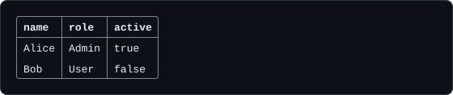

# Table

`table(data, options?)` turns an array of rows into an aligned, optionally bordered block of text. It is a plain function exported from the package: no `CLI` instance is needed, and it can be imported into any Node script. It returns a string and prints nothing on its own.



## A first example

```ts
import { table } from "@libraz/node-cli";

const rows = [
  { name: "Alice", role: "Admin", active: true },
  { name: "Bob", role: "User", active: false },
];

console.log(table(rows, { border: "rounded" }));
```

The return value carries **no trailing newline**, and an input that produces nothing to render returns `""`. Pass the result to `console.log`, or inside a command to the context's output stream (see [Commands](commands.md)):

```ts
import { createCLI, table } from "@libraz/node-cli";

const cli = createCLI({ name: "mycli" });

cli.command("users").action((ctx) => {
  const rows = [{ name: "Alice", role: "Admin" }];
  ctx.stdout.write(`${table(rows, { border: "rounded" })}\n`);
});
```

## Input shapes

`table` accepts two shapes.

**An array of objects.** Each object is a row and each property is a column.

```ts
import { table } from "@libraz/node-cli";

console.log(
  table([
    { id: 1, name: "Alice" },
    { id: 2, name: "Bob" },
  ]),
);
```

Columns default to the **union of all rows' keys**, in the order they are first seen, so a key that appears only on a later row is still rendered.

**An array of arrays.** Each inner array is a row.

```ts
import { table } from "@libraz/node-cli";

console.log(
  table([
    ["name", "role"],
    ["Alice", "Admin"],
    ["Bob", "User"],
  ]),
);
```

By default row 0 is consumed as the header row. Supplying `columns` changes that: the supplied entries become the header and **every** array row is treated as data.

The column count is the longest row; shorter rows are padded with empty cells. `null` and `undefined` cells render as `""`. Every cell value is converted with `String()` and then passed through `sanitizeTerminalText` (see [Color](color.md)), which keeps color codes but strips cursor movement, screen erasing, and other escape sequences that would otherwise break the frame.

### Describing columns

`columns` takes a readonly array whose entries are either a plain string or a `ColumnSpec`. A string is shorthand for `{ key: string }`.

```ts
import { table } from "@libraz/node-cli";

const rows = [
  { id: 1, name: "Alice", score: 42 },
  { id: 2, name: "Bob", score: 7 },
];

console.log(
  table(rows, {
    columns: [
      "id",
      { key: "name", label: "Full name", maxWidth: 10 },
      { key: "score", align: "right" },
    ],
  }),
);
```

For object data, `key` names the property to read, `label` replaces the header text (it defaults to `key`), and `columns` also selects and orders the columns.

For array data, columns are matched **by position** and `key` is not used to look anything up. An entry that is a string is the header text; a `ColumnSpec` contributes `label ?? key`. The per-column settings follow the same position.

```ts
import { table } from "@libraz/node-cli";

console.log(
  table(
    [
      ["Alice", 42],
      ["Bob", 7],
    ],
    { columns: ["Name", { key: "score", label: "Score", align: "right" }] },
  ),
);
```

## `TableOptions`

| Field | Type | Default | Behavior |
| --- | --- | --- | --- |
| `columns` | `readonly (string \| ColumnSpec)[]` | derived from the data | The columns to render, in order. For array data, supplying it means row 0 is **not** consumed as a header. |
| `header` | `boolean` | `true` | `false` suppresses the header row. |
| `border` | `"none" \| "simple" \| "rounded" \| "single" \| "double" \| "custom"` | `"none"`, or `"custom"` when `chars` is supplied | Border preset. |
| `chars` | `TableChars` | — | Custom border glyphs, merged over the preset that `border` selects (`single` when `border` is omitted or `"custom"`). |
| `borderColor` | `StyleSpec` | — | A style name or dot-chained styles, such as `"dim"` or `"cyan.bold"`, applied to the border glyphs. |
| `headerStyle` | `StyleSpec \| "none"` | `"bold"` | Style applied to the header text. `"none"` leaves it plain. |
| `paddingLeft` | `number` | `1` with a frame, `0` for `none` / `simple` | Spaces inside each cell, on the left. |
| `paddingRight` | `number` | same as above | Spaces inside each cell, on the right. |
| `gap` | `number` | `2` | Spaces between columns. Applies to `border: "none"` only. |
| `rowSeparators` | `boolean` | `false` | `true` inserts a separator line between every pair of data rows in the `"simple"` and framed borders. It has no effect with `border: "none"`, which has no separator glyph. |
| `ellipsis` | `string` | `"…"` | Marker appended to a cell that had to be cut. |
| `stream` | `Writable` | `process.stdout` | Decides whether color is emitted: a TTY gets color. `table` never writes to it. |

`gap`, `paddingLeft` and `paddingRight` are integers of 0 or more.

## `ColumnSpec`

| Field | Type | Default | Behavior |
| --- | --- | --- | --- |
| `key` | `string` | required | The object property to read. Array data ignores it. |
| `label` | `string` | `key` | Header text for the column. |
| `align` | `"left" \| "right" \| "center"` | `"left"` | Alignment of the header and the cells. |
| `width` | `number` | automatic | Fixed **total** width of the column, **padding included**. A positive integer. |
| `maxWidth` | `number` | no limit | Upper bound on the **content** width, padding excluded. A positive integer, or `Infinity` for no limit. |

`width` and `maxWidth` measure different things. `width` is the whole column including `paddingLeft` and `paddingRight`; the content gets what is left, with a floor of 1, so a `width` below `paddingLeft + paddingRight + 1` renders at that minimum. `maxWidth` caps the content only. When both are set, `width` wins.

## Styles

`headerStyle` and `borderColor` take a style name or a dot-chained list such as `"cyan.bold"`. Every segment is checked when `table()` is called, and an unknown name throws a `RangeError` with code `ERR_INVALID_ARG_VALUE`. The available style names are listed in [Color](color.md).

Color is decided by `stream`. The default is `process.stdout`; pass the stream you will write to so a redirected or non-TTY target receives plain text. `NO_COLOR`, `FORCE_COLOR` and `setColorEnabled` apply as they do everywhere else in the library.

```ts
import { table } from "@libraz/node-cli";

const rows = [{ name: "Alice", role: "Admin" }];

process.stderr.write(
  `${table(rows, {
    border: "rounded",
    headerStyle: "cyan.bold",
    borderColor: "dim",
    paddingLeft: 2,
    paddingRight: 2,
    stream: process.stderr,
  })}\n`,
);
```

## Validation

Invalid options throw before anything is rendered, always with a `code`:

| Input | Error |
| --- | --- |
| A `width`, `maxWidth`, `gap`, `paddingLeft` or `paddingRight` that is not a number, or a `columns` entry that is not a string or a `ColumnSpec` with a string `key` (including `undefined`) | `TypeError` `ERR_INVALID_ARG_TYPE` |
| `width` or `maxWidth` of 0 or less, `NaN` or fractional; `width` of `Infinity`; a negative, `NaN`, infinite, fractional or unsafe `gap` or padding | `RangeError` `ERR_INVALID_ARG_VALUE` |
| An unknown `border`, or an unknown name in `headerStyle` or `borderColor` | `RangeError` `ERR_INVALID_ARG_VALUE` |

Values up to 2^32 are accepted for widths and padding; a span larger than 4096 cells is capped when rendering.

## Borders

| Preset | Corners | Notes |
| --- | --- | --- |
| `"none"` | — | No frame at all; columns are separated by `gap` spaces. The default. |
| `"simple"` | — | No outer frame; `-` separator lines and ` \| ` between columns. |
| `"rounded"` | `╭ ╮ ╰ ╯` | Full frame with rounded corners. |
| `"single"` | `┌ ┐ └ ┘` | Full frame with square corners. |
| `"double"` | `╔ ╗ ╚ ╝` | Full frame drawn with double lines. |
| `"custom"` | from `chars` | Starts from the `single` preset and applies `chars` over it. |

`chars` accepts these keys, each a string: `top`, `topMid`, `topLeft`, `topRight`, `bottom`, `bottomMid`, `bottomLeft`, `bottomRight`, `left`, `leftMid`, `right`, `rightMid`, `horizontal` (the line between rows), `cross` (where that line meets a column divider) and `vertical` (the divider between columns). Supplying `chars` without `border` implies `border: "custom"`.

```ts
import { table } from "@libraz/node-cli";

const rows = [{ name: "Alice", role: "Admin" }];

console.log(
  table(rows, {
    chars: { topLeft: "+", topRight: "+", bottomLeft: "+", bottomRight: "+" },
  }),
);
```

## Widths and truncation

Column width is derived from the widest cell, measured in **display columns** rather than JavaScript string length, so Japanese, emoji, and other wide text align correctly. Colors add no width. The measurement is `stringWidth`, documented in [Color](color.md).

Two `ColumnSpec` fields constrain the result, and they mean different things:

- `maxWidth` caps the **content** width of one column. A cell wider than the cap is truncated with the `ellipsis` marker.
- `width` fixes the **total** width of one column, **padding included**. The content width becomes `width - paddingLeft - paddingRight`, with a floor of 1.

```ts
import { table } from "@libraz/node-cli";

const rows = [{ name: "Alice", role: "Admin", note: "promoted last quarter" }];

console.log(
  table(rows, {
    border: "single",
    columns: [{ key: "name", maxWidth: 12 }, { key: "role", width: 20 }, "note"],
  }),
);
```

Header labels are truncated to the same width as the data cells, so a narrow column cannot leave an over-wide header sticking out of the frame.

## Common surprises

- **`border` defaults to `"none"`, not to a boxed style.** A table with no `border` option is a plain aligned block. Pass `border: "rounded"` (or another preset) to get a frame.
- **The table never wraps.** A cell too wide for its column is truncated with the marker, never folded onto a second line. Embedded newlines were already collapsed to spaces during sanitizing, so a multi-line cell is not possible.
- **The total width is never clamped to the terminal width.** A wide table will wrap in the terminal itself unless `maxWidth` or `width` keeps it narrow.
- **`width` includes the padding, `maxWidth` does not.** With the default frame padding of 1 on each side, `width: 20` leaves 18 cells of content.
- **A zero width is an error, not "automatic".** Omit `width` and `maxWidth` to size a column from its content; use `maxWidth: Infinity` to say "no limit" explicitly.
- **Per-column settings follow the entry, not a separate map.** For array data they follow the position in `columns`, since `key` is not looked up.
- **`stream` only decides color.** `table` returns a string with no trailing newline and writes nothing.

## Related pages

- [Color](color.md) — width measurement, style names, and text sanitizing.
- [Commands](commands.md) — writing a table to `ctx.stdout`.
- [Examples](examples.md) — complete programs that render tables.
