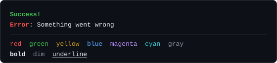

# カラー

`color` は文字列に端末のカラーとテキストスタイルを適用し、`colorTag` はテンプレートリテラルの中で同じことを行います（`createColorTag` はそのタグを別のストリームに結び付けます）。加えて、エスケープシーケンスを含むテキストを測定・切り詰め・無害化する文字列ユーティリティ群があります。いずれもパッケージが公開する素の関数で、`CLI` インスタンスは要りません。どの Node スクリプトからでも import できます。



## 最初の例

```ts
import { color, colorTag } from "@libraz/node-cli";

console.log(color.bold.green("Success!"));
console.log(colorTag`{bold.red Error}: Something went wrong`);

console.log(
  [
    color.red("red"),
    color.green("green"),
    color.yellow("yellow"),
    color.blue("blue"),
    color.magenta("magenta"),
    color.cyan("cyan"),
    color.gray("gray"),
  ].join("  "),
);

console.log([color.bold("bold"), color.dim("dim"), color.underline("underline")].join("  "));
```

各スタイル関数は文字列を受け取り、文字列を返します。結果を `console.log` に渡すか、ストリームへ書き込むまでは何も表示されません。

### スタイル関数が実際に返すもの

端末は **ANSI エスケープシーケンス** を受け取るとカラーを描画します。これは目に見えない制御文字の短い並びで、端末に「ここから緑で描く」と伝え、後から「やめる」と伝えます。`color.green("ok")` は、この2つの記号でテキストを挟んだ文字列を返します。記号は画面上の幅を占めませんが、文字列としては実在します。`"ok".length` と着色後の文字列の長さが食い違うのはそのためです。長さが結果を左右する場面では、`.length` ではなく [`stringWidth`](#stringwidthtext-number) を使ってください。

## スタイルの連結

`color` は連結可能なオブジェクトです。すべてのスタイル名がプロパティになっており、そのプロパティ自身も関数でありながら、残りのスタイル名をプロパティとして持ちます。連結は左から右へ読み、並べたスタイルをまとめて適用します。

```ts
import { color } from "@libraz/node-cli";

console.log(color.bold.underline("Title"));
console.log(color.bgYellow.black("  WARNING  "));
```

スタイルではない名前にアクセスすると、TypeScript では型エラーになり、実行時には `code: "ERR_INVALID_ARG_VALUE"` を持つ `RangeError` を投げます。メッセージには有効な名前の一覧が入るため、打ち間違いは黙って素のテキストを返すのではなく、その場で失敗します。名前が実行時にしか分からない場合は、先に `isStyleName(value)` で確かめてください。任意の `unknown` の値を受け取り、`StyleName` に絞り込みます。`then`、`toString`、`valueOf`、`toJSON`、`constructor`、およびあらゆるシンボルはそのまま素通りするので、カラライザを await したり、文字列化やシリアライズをしたりしても例外にはなりません。

## スタイルの一覧

このパッケージが対応するスタイルはこれですべてです。bright 系の変種も、256色パレットも、16進数や RGB の API もありません。

| グループ | 名前 |
| --- | --- |
| 修飾 | `bold`, `dim`, `italic`, `underline`, `inverse`, `strikethrough` |
| 前景色 | `black`, `red`, `green`, `yellow`, `blue`, `magenta`, `cyan`, `white`, `gray`, `grey` |
| 背景色 | `bgRed`, `bgGreen`, `bgYellow`, `bgBlue`, `bgMagenta`, `bgCyan`, `bgWhite` |

`grey` は `gray` の別名です。`bgBlack` はありません。

### スタイルの型

- `StyleName` は上の23個の名前の union です。
- `Colorizer` は `color` と `createColorizer` が返すオブジェクトの型で、`StyleName` ごとに連結可能な `ColorFn` を1つ持ちます。連結のキーは `StyleName` に限られるため、`color.red.bol` はコンパイルできません。
- `ColorTag` は `colorTag` と `createColorTag` が返すタグの型で、`{style content}` のマークアップを描画するタグ付きテンプレートの関数です。
- `StyleSpec` はスタイル名、またはドットでつないだスタイル名の連なり（`"cyan"`、`"cyan.bold"`、`"cyan.bold.underline"`）で、スタイルを受け取るオプションが使います。1つ目と2つ目はコンパイラが検査し、3つ目以降は値を使うときに検査されます。

```ts
import { color, isStyleName, type StyleName } from "@libraz/node-cli";

function paint(name: string, text: string): string {
  if (!isStyleName(name)) throw new Error(`not a style: ${name}`);
  const style: StyleName = name;
  return color[style](text);
}
```

## 入れ子

スタイルは安全に入れ子にできます。内側の層が閉じたエスケープシーケンスの後で各層が自分を開き直すため、入れ子の断片より後ろのテキストも外側のスタイルを保ちます。

```ts
import { color } from "@libraz/node-cli";

console.log(color.red(`x ${color.green("y")} z`));
// "x" and "z" stay red; only "y" is green
```

## `colorTag` タグによるインラインマークアップ

`colorTag` はタグ付きテンプレートです。バッククォート文字列の直前に書き、その文字列を変換します。関数呼び出しを入れ子にする代わりに、`{style content}` というマークアップを描画します。

```ts
import { colorTag } from "@libraz/node-cli";

const port = 3000;

console.log(colorTag`Status: {green OK}`);
console.log(colorTag`{bold.red Error}: broken`);
console.log(colorTag`Listening on {cyan http://localhost:${port}}`);
console.log(colorTag`{yellow outer {bold inner} outer}`);
```

構文は厳密です。

- 開き波括弧 `{`
- スタイル名、またはドットで連結した複数のスタイル名
- **空白ちょうど1つ**
- 対応する `}` までの内容

波括弧は数を数えているため、マークアップは入れ子にできます。

スタイル名が未知の場合、空白が欠けている場合、波括弧の対応が取れていない場合は、`{` が **そのまま文字として** 出力され、残りのテキストには手が加わりません。`color.foo` と違って `colorTag` は不正なマークアップで例外を投げません。唯一の例外は深さで、64段を超える入れ子のマークアップは `code: "ERR_INVALID_ARG_VALUE"` を持つ `RangeError` になります。

補間された値は、マークアップの描画が済んだ **後で** 文字列に変換されて差し込まれます。そのため補間値の中の `{` がマークアップとして解釈されることはなく、信頼できないデータからスタイルを注入されることもありません。

## カラーが有効になる条件

有効かどうかは、モジュールを import した時点ではなく **スタイル関数を呼び出したその瞬間** に判定されます。`color` と `colorTag` は `process.stdout` を基準に判定します。`createColorizer(stream)` は、同じ連結可能なオブジェクトを別のストリームに結び付けて返し、`createColorTag(stream)` はタグについて同じことを行います（`colorTag` はそのタグを `process.stdout` に結び付けたものです）。どちらも任意の `Writable` を受け取り、それ以外には `TypeError`（`ERR_INVALID_ARG_TYPE`）を投げます。定義済みで stream でない値を `isColorEnabled(stream)` に渡した場合も同じです。スタイル関数も、文字列でないテキストには色の有効・無効にかかわらず同じ `TypeError` を投げ、`colorTag` はタグとしてではなく普通の関数として呼ぶと投げます。

```ts
import { createColorizer, createColorTag } from "@libraz/node-cli";

const errColor = createColorizer(process.stderr);
console.error(errColor.red("failed"));

const e = createColorTag(process.stderr);
console.error(e`{bold.red Error}: broken`);
```

`isColorEnabled(stream?)` はその判定を直接返します。引数を省略した場合の対象は `process.stdout` です。判定は次の順に進み、最初に当てはまった規則で決まります。

1. `setColorEnabled(true)` / `setColorEnabled(false)` による明示的な上書き。`NO_COLOR` を含め、他のすべてに優先します。
2. `NO_COLOR` が空でない値: カラーは無効。
3. `FORCE_COLOR` が空でない値: `"0"` または `"false"` なら無効、それ以外の値なら有効。`TERM=dumb` にも、端末ではないストリームにも優先します。
4. `TERM` が `"dumb"`: カラーは無効。
5. それ以外は、ストリームが **端末** かどうかで決まります。端末とは対話的なコンソールのことで、ファイルや他プログラムへのパイプは該当しません。

```ts
import { isColorEnabled, setColorEnabled } from "@libraz/node-cli";

setColorEnabled(false); // force plain text, e.g. inside a test
isColorEnabled(); // false
setColorEnabled("auto"); // drop the override, return to automatic detection
```

`NO_COLOR`、`FORCE_COLOR=0`、`setColorEnabled(false)` のいずれかでカラーが無効なときは、`bold` や `underline` などの修飾を含め、すべてのスタイルが取り除かれます。関数は文字列をそのまま返し、インラインマークアップは除去されます。

`setColorEnabled` はモジュール全体で1つのフラグを設定します。ストリームごとの設定ではありません。一度設定すると、`setColorEnabled("auto")` で解除するまですべてのカラライザがそれに従います。

## 文字列ユーティリティ

これらの関数が必要なのは、エスケープシーケンスを含む文字列を通常の文字列メソッドでは測定も切断もできないためです。`"\x1b[31mred\x1b[39m".length` は 13 で、`"日本".length` は 2 ですが端末では4カラム幅を占めます。どちらもそのまま切ると、エスケープシーケンスや文字を途中で断ち切ってしまいます。

### `stringWidth(text): number`

テキストが端末で何カラム幅を占めるかを返します。まずエスケープシーケンスを取り除き、次にテキストを **書記素** へ分割します。書記素は読み手が1文字として認識する単位で、肌の色の修飾が付いた絵文字のように、複数のコードポイントから成る場合もあります。

- 結合文字（Unicode の一般カテゴリ Mn と Me）、書式文字（Cf。ゼロ幅接合子や双方向制御の記号を含みます）、制御文字は 0 と数えます。
- East Asian Width が Wide または Fullwidth の文字と、絵文字表示の文字は 2 と数えます。
- U+FE0F（絵文字表示）または U+20E3（キーキャップ）を伴う書記素は 2 と数えます。

書記素の分割には `Intl.Segmenter` を使うため、家族絵文字のような連結された絵文字列も、構成要素の合計ではなく2カラム幅の1セルとして扱われます。[テーブル](table.md)が使う測定もこれで、セルに日本語が入っても列が揃うのはこの測定のおかげです。

```ts
import { stringWidth } from "@libraz/node-cli";

stringWidth("abc"); // 3
stringWidth("日本語"); // 6
stringWidth("\x1b[31mred\x1b[39m"); // 3
```

### `stripAnsi(text): string`

CSI シーケンス（カラー、カーソル移動、画面消去）、OSC シーケンス（ウィンドウタイトル、ハイパーリンク）、DCS・SOS・PM・APC の制御文字列、そのほかのエスケープを含め、ANSI エスケープシーケンスをすべて取り除きます。テキストの途中で終わっているシーケンスは、端末が読み込むのと同じくテキストの末尾まで取り除きます。端末の出力をログファイルへ書き出す前に使ってください。

### `truncateAnsi(text, width, ellipsis = "…"): string`

テキストを表示幅で最大 `width` カラムまで縮め、`ellipsis` を末尾に付けます。書記素を途中で分断せず、記号の分の幅も含めて収め、残した部分の中にあったエスケープシーケンスは保持し、切り詰めで開いたままになったスタイルやハイパーリンクを閉じるためのエスケープを末尾に補います。スタイルはその属性だけを戻すリセットで閉じるため、後に続くテキストには外側の `color.*` が付けたスタイルが残ります。`width` は正の整数か、上限なしを表す `Infinity` でなければなりません。`0`、負数、`NaN`、`-Infinity`、小数は `code: "ERR_INVALID_ARG_VALUE"` を持つ `RangeError` になり、数値でない値は `code: "ERR_INVALID_ARG_TYPE"` を持つ `TypeError` になります。

```ts
import { truncateAnsi } from "@libraz/node-cli";

truncateAnsi("a very long line", 8); // "a very …"
```

### `splitAnsi(text): readonly AnsiSegment[]`

テキストを順序を保った区間へ分割します。各区間は `{ ansi: boolean; text: string }` です。`ansi: true` の区間がエスケープシーケンスで、残りが可視テキストです。すべての `.text` を連結すると入力がそのまま再現されるため、エスケープを壊さずに可視テキストだけを加工する土台になります。

### `splitGraphemes(text): readonly string[]`

テキストを書記素クラスタへ分割します。入力にエスケープシーケンスを含めてはいけません。エスケープも通常のテキストと同じように分割されるため、その文字が書記素として数えられてしまいます。先に `splitAnsi` で分け、`ansi` が `false` の区間だけを分割してください。

```ts
import { splitAnsi, splitGraphemes } from "@libraz/node-cli";

const input = "\x1b[31m日本語\x1b[39m";
const units = splitAnsi(input).flatMap((segment) =>
  segment.ansi ? [segment.text] : splitGraphemes(segment.text),
);
```

### `sanitizeTerminalText(text, options?): string`

信頼できない文字列を、そのまま表示しても安全な形にします。オプションは `SanitizeTerminalTextOptions` で、`{ singleLine = true, allowHyperlinks = true }` です。

- カラーとスタイルのシーケンス（SGR。`ESC [` に続いて数字・`;`・`:` だけから成るパラメータ、最後に `m`）は残します。
- 終端された OSC 8 のハイパーリンクは、`id=` などのパラメータの有無にかかわらず、`allowHyperlinks: false` を指定しない限り残します。指定した場合は開始と終了の両方を破棄します。
- **それ以外のエスケープシーケンスはすべて破棄します。** カーソル移動、画面消去、ウィンドウタイトルの変更、スクロール領域の変更が該当します。
- 単一行モードでは改行が空白になります。`singleLine: false` なら改行は残ります。
- タブ、垂直タブ、改ページ、復帰は、それぞれ空白1つになります。
- その他の制御バイトはすべて破棄します。
- テキストが閉じ忘れたスタイルやハイパーリンクは、返す文字列の末尾で閉じます。スタイルはその属性だけを戻すリセットで閉じるため、後に続くテキストには影響しません。

これが重要なのは、端末が届いたエスケープシーケンスをそのまま実行するためです。ファイル名や HTTP レスポンス、データベースの行から取った文字列は、放っておけば画面を消したり、既に出力した内容の上へカーソルを動かしたり、ウィンドウタイトルを書き換えたりできてしまいます。`sanitizeTerminalText` を通せば、カラーを保ったままその力だけを取り除けます。テーブルのセルとプログレスのラベルは、既にこの処理を通っています。

```ts
import { sanitizeTerminalText } from "@libraz/node-cli";

const fromDatabase = "release \x1b[2J\x1b[Hv2";
console.log(sanitizeTerminalText(fromDatabase)); // "release v2" — the screen is not cleared
```

### `isTTY(value: unknown): boolean`

値がファイルやパイプではなく端末のストリームかどうかを返します。任意の値を受け取り、`isTTY === true` を持つオブジェクト以外は `false` です。`isStyleName(value)` と `isLogLevel(value)`（[ロギング](logging.md)を参照）も同じ形の引数を取ります。任意の値を受け取り、型ガードで答えます。

## よくある落とし穴

- **有効判定は呼び出しごとに行われます。** モジュールを import した後に `FORCE_COLOR` を設定しても効きますし、`setColorEnabled` は以後の呼び出しに適用されます。
- **カラーを無効にすると修飾も消えます。** `NO_COLOR` と `setColorEnabled(false)` は、色と一緒に `bold` や `underline` も取り除きます。
- **`setColorEnabled` はストリーム単位ではなくグローバルです。** `createColorizer` で作ったカラライザもこれに従います。`setColorEnabled("auto")` で自動判定に戻ります。
- **`color.foo` は例外を投げ、`colorTag` は投げません。** 未知のスタイル名は、`color` では `RangeError`（コンパイル時には型エラー）になり、インラインマークアップでは文字どおりの `{` になります。
- **空白の欠落はインラインマークアップを黙って壊します。** `` colorTag`{green OK}` `` は `OK` を着色しますが、`` colorTag`{greenOK}` `` は `{greenOK}` をそのまま表示します。
- **`.length` は幅ではありません。** エスケープシーケンスは長さを増やし、全角文字は幅を増やします。`stringWidth` を使ってください。
- **`bgBlack` はなく、bright 系も RGB もありません。** 上の一覧がすべてです。

## 関連ページ

- [テーブル](table.md) — 列を揃えるために同じ幅の測定を使います。
- [ロギング](logging.md) — ストリームごとにアイコンを着色します。
- [プログレス](progress.md) — バーとスピナーにスタイル名を受け取ります。
- [用語集](glossary.md) — 端末、エスケープシーケンス、書記素。
