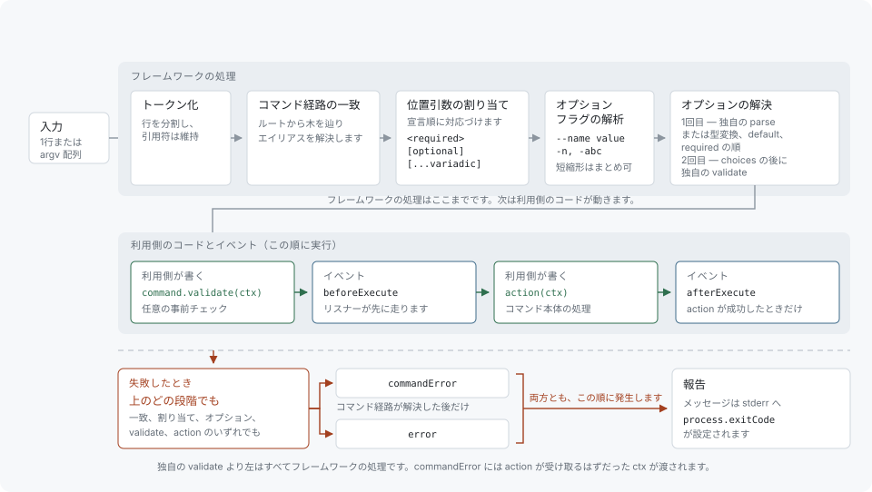

# コマンド

コマンドは、名前を入力して呼び出す名前付きの動作です。`cli.command()` はコマンドを 1 つ宣言し、それを設定するためのビルダーを返します。

このページではコマンド名、位置引数、サブコマンド、そしてコマンドが実行時にたどるライフサイクルを扱います。`--force` のようなフラグは[オプション](options.md)で扱います。

## コマンドを定義する

`cli.command()` は仕様文字列を 1 つ受け取り、`CommandBuilder` を返します。そこに `description()` と `action()` をチェーンでつなげます。

```typescript
import { createCLI } from "@libraz/node-cli";

const cli = createCLI({ name: "myapp" });

cli
  .command("ping")
  .description("Check connectivity")
  .action((ctx) => {
    ctx.stdout.write("pong\n");
  });

await cli.start();
```

コマンドはチェーンが終わった時点ではなく `cli.command()` の実行中に登録されるため、呼び出しが返った時点ですでに存在しています。ビルダーのメソッドはすべて同じビルダーを返すので、チェーンする順序は問いません。

アクションは引数を 1 つ、[コマンドコンテキスト](#コマンドコンテキスト)を受け取ります。出力は `console.log` ではなく `ctx.stdout` を通して書き込んでください。対話シェルとテストで出力の振り分けが正しく働きます。

### ビルダーメソッド

| メソッド | 効果 |
|---|---|
| `description(text)` | ヘルプでコマンドの横に表示される文言を設定します |
| `option(flags, schema)` | フラグを宣言します — [オプション](options.md)を参照 |
| `action(fn)` | コマンドがディスパッチされたときに実行する関数を設定します |
| `alias(...names)` | コマンドの別名を追加します |
| `hidden(hidden = true)` | ヘルプと補完からコマンドを隠します |
| `validate(fn)` | アクションの前に走るチェックを設定します |
| `cancel(fn)` | コマンドが中断されたときに走るハンドラを設定します |
| `complete(fn)` | 独自のタブ補完プロバイダを設定します — [対話シェル](interactive-shell.md)を参照 |
| `command(spec)` | このコマンドの下にサブコマンドを宣言します |
| `remove()` | コマンドの登録を解除します |

`default()`、`example()`、`usage()`、`argument()` にあたるメソッドはありません。使用法の行は仕様文字列から生成され、コマンド名を省いたときに走る既定コマンドという概念もありません。

## 引数仕様の構文

仕様文字列は空白で分割されます。各トークンは先頭の文字で分類されます。

- `<` または `[` で始まるトークンは**位置引数**を宣言します。フラグ名を伴わず、決まった位置に入力する値です。
- それ以外のトークンは**素の名前**です。最後の素の名前がコマンド自身で、それより前の素の名前はすべて親コマンドになります。

```typescript
cli.command("deploy <env> [region]");
//           ^^^^^^ command name
//                  ^^^^^ required argument
//                        ^^^^^^^^ optional argument
```

認識される括弧の形は 4 つです。

| トークン | 意味 | `ctx.args` での値 |
|---|---|---|
| `<name>` | 必須、値はちょうど 1 つ | `string` |
| `[name]` | 任意、値は最大 1 つ | `string`、またはキー自体が存在しない |
| `<...name>` | 必須の可変長 — 値は 1 つ以上 | `string[]`、空にはならない |
| `[...name]` | 任意の可変長 — 値は 0 個以上 | `string[]`、空の場合もある |

*可変長*とは、値をちょうど 1 つ取るのではなく、残りの値をすべて配列へ集めることを指します。[用語集](glossary.md)を参照してください。

### 実際の動作

```typescript
cli.command("copy <source> [dest]").action((ctx) => {
  const source = ctx.args.source as string;
  const dest = (ctx.args.dest as string | undefined) ?? ".";
  ctx.stdout.write(`${source} -> ${dest}\n`);
});
```

| 入力 | 結果 |
|---|---|
| `myapp copy a.txt b.txt` | `ctx.args` は `{ source: "a.txt", dest: "b.txt" }` |
| `myapp copy a.txt` | `ctx.args` は `{ source: "a.txt" }` — `dest` キーは存在しません |
| `myapp copy` | `MissingArgumentError`。コマンドの使用法の行を伴います |
| `myapp copy a.txt b.txt c.txt` | `c.txt` に対する `ExtraArgumentError` |

可変長引数にすると、最後の行の挙動が変わります。

```typescript
cli.command("copy <...files>").action((ctx) => {
  const files = ctx.args.files as string[];
  ctx.stdout.write(`${files.length} file(s)\n`);
});
```

| 入力 | 結果 |
|---|---|
| `myapp copy a.txt b.txt c.txt` | `ctx.args.files` は `["a.txt", "b.txt", "c.txt"]` |
| `myapp copy a.txt` | `ctx.args.files` は `["a.txt"]` |
| `myapp copy` | `...files` に対する `MissingArgumentError` |

### 仕様が不正なときに送出されるエラー

以下は `cli.command()` の実行中に通常の `Error` オブジェクトとして送出されます。不正な仕様は、ユーザーがコマンドを入力した時点ではなく起動時に失敗します。

- 引数トークンの後ろに素の名前が現れる（`"deploy <env> now"`）。
- 素の名前がまったく含まれない（`"<env>"`）。
- 括弧の閉じ文字が欠けている（`"deploy <env"`）。
- 引数名が空（`"deploy <>"`）。
- 2 つの引数が同じ名前を共有する（`"copy <file> [file]"`）。
- 任意引数の後ろに必須引数が続く（`"copy [dest] <source>"`）。
- 可変長引数が最後になっていない（`"copy <...files> <dest>"`）。

### 仕様がサポートしないもの

| 書いた内容 | 実際の意味 |
|---|---|
| `[name=foo]` | 文字どおり `name=foo` という名前の任意引数 — 仕様に既定値はありません |
| `<port:number>` | 文字どおり `port:number` という名前の引数 — 型注釈はありません |
| `<dev\|prod>` | 文字どおり `dev\|prod` という名前の引数 — 共用体はありません |
| `deploy <env> ...` | 末尾の `...` は括弧の形ではないので素の名前として読まれ、引数の後ろの素の名前はエラーになります |

既定値、型、選択肢、検証は位置引数ではなく[オプション](options.md)が受け持ちます。

## 実行時の位置引数

`ctx.args` は、仕様文字列に書いた名前をキーとして位置引数を保持します。保持されうる値は次の 4 つの規則で説明できます。

**値は常に文字列です。** 可変長でない引数は `string`、可変長引数は `string[]` です。変換は一切行われないので、数値の引数はアクションの中で変換します。

```typescript
cli.command("wait <seconds>").action((ctx) => {
  const seconds = Number(ctx.args.seconds as string);
  if (!Number.isFinite(seconds)) throw new Error("seconds must be a number");
  ctx.stdout.write(`waiting ${seconds}s\n`);
});
```

**可変長引数は常に配列になります。** `[...name]` ではその配列が空になることもあり、`<...name>` で値が 0 個の場合はアクションが走る前に `MissingArgumentError` で拒否されます。

**任意引数を省くと、そのキー自体が存在しません。** キーが `undefined` という値で存在するわけではありません。読み出せば `undefined` が返るので、既定値はたいてい `??` で書きます。この違いが問題になる場合は `Object.hasOwn` でキーの有無を調べます。

```typescript
cli.command("copy <source> [dest]").action((ctx) => {
  if (Object.hasOwn(ctx.args, "dest")) {
    // The user supplied a destination.
  }
});
```

`ctx.args` は null プロトタイプのオブジェクトで、通常の `Object` のメソッドを継承しません。`ctx.args.hasOwnProperty("dest")` は `TypeError` を送出します。動く形は `Object.hasOwn(ctx.args, "dest")` です。

**余った値はエラーになります。** コマンドが宣言した数より多くの位置値を与え、かつそのコマンドがアクションを持つ場合、最初の余分な値を名指しした `ExtraArgumentError` が送出されます。[エラー](errors.md)を参照してください。

## サブコマンドとグループ

コマンドは別のコマンドの下に入れ子にできます。同じ構造を宣言する形が 2 つあります。

```typescript
// Path form: the last bare name is the command, earlier names are parents.
cli.command("db migrate").action(runMigrations);

// Builder form: keep a reference to the parent and call .command() on it.
const db = cli.command("db").description("Database operations");
db.command("migrate").action(runMigrations);
db.command("seed").action(seedDatabase);
```

パス形式では、まだ存在しない親は**グループ**として自動的に作られます。グループとは名前を持ちアクションを持たないコマンドです。ビルダー形式では、`action()` を設定しないかぎり `cli.command("db")` がそのグループそのものです。


ディスパッチは入力されたトークンをルートから順にたどり、そこまでに一致したコマンドのサブコマンドと各トークンを照合して、どれにも一致しない最初のトークンで停止します。残ったものはすべて引数とオプションになります。

グループはアクションを持たないため実行できません。挙動は次のとおりです。

- 追加の入力がない場合（`myapp db`）は自身のヘルプページを表示し、サブコマンドを一覧します。
- 追加の入力がある場合（`myapp db bogus`）は未知のコマンドとして報告します。`cli.catch()` でフォールバックハンドラが登録されていれば、代わりにそのハンドラが入力を受け取ります。登録されていなければ、利用可能なサブコマンドの一覧を伴う `CommandNotFoundError` が送出されます。

### 同じパスを再登録する

同じコマンドパスを二度宣言すると、コマンドを置き換えたり重複させたりせず、2 つの宣言をマージします。`action`、`description`、補完プロバイダ、`aliases`、`validate`、キャンセルハンドラは、新しい宣言が値を設定していればそれぞれ従来の値を上書きします。オプションはキーごとにマージされます。位置引数のリストは丸ごと置き換えられ、空のリストで置き換えることもできます。

```typescript
cli.command("status <target>").action(showStatus);
cli.command("status").description("Show status"); // argument list is now empty
```

これは、[プラグイン](events-and-plugins.md)が別のモジュールですでに宣言されたコマンドに手を入れるための仕組みです。

### 落とし穴: 到達できないサブコマンド

ディスパッチは、**アクションと 1 つ以上の位置引数の両方**を持つ最初のコマンドで下降を止めます。そこから先のトークンはすべて引数の値として扱われ、サブコマンド名として扱われることはありません。したがって、そうしたコマンドの下にあるサブコマンドは決してディスパッチされません。

```typescript
// Broken: `task` runs and takes an argument, so `list` is only ever an argument.
const task = cli.command("task <name>").action(runTask);
task.command("list").action(listTasks);

// `myapp task list` runs runTask with ctx.args.name === "list".
```

これは黙って起きるわけではありません。登録時に `process.emitWarning` を通じてコード `NODE_CLI_UNREACHABLE_SUBCOMMAND` の警告が出ます。ヘルプとタブ補完はどちらも到達できないサブコマンドを省くので、実行できないものがインターフェースに現れることはありません。

対処は、親からアクションと位置引数の両方を取り除き、引数をサブコマンド側へ移すことです。

```typescript
const task = cli.command("task").description("Task operations");
task.command("run <name>").action(runTask);
task.command("list").action(listTasks);

// myapp task run build
// myapp task list
```

仕様文字列で引数の後ろの素の名前が拒否される理由も、同じ規則で説明できます。`cli.command("task <name> list")` は、まさにこの到達できない構造を書き表したものだからです。

## エイリアス

`alias()` はコマンドの別名を追加します。

```typescript
cli.command("deploy <env>").alias("d", "dep").action(deploy);

// myapp deploy prod
// myapp d prod
// myapp dep prod
```

エイリアスはサブコマンドを含め、どの階層でも使えます。

```typescript
const user = cli.command("user");
user.command("create <name>").alias("c", "new").action(createUser);

// myapp user new Alice
```

エイリアスはアクションが走る前に本来のコマンド名へ解決されるので、`ctx.commandPath` が保持するのは常に正規のパスです。`["user", "create"]` であって `["user", "new"]` にはなりません。

エイリアスは登録時に検査されます。兄弟コマンドの名前と衝突するエイリアスや、別の兄弟がすでに使っているエイリアスを追加すると例外が送出されます。同じ名前なら実在のコマンドが常に優先されるため、エイリアスがコマンドを覆い隠すことはありません。

## 非表示コマンド

`hidden()` はコマンドをヘルプの一覧とタブ補完から取り除きます。

```typescript
cli.command("debug-dump").hidden().action(dumpState);
```

コマンド自体は変わらずディスパッチできます。`myapp debug-dump` は実行されますし、`myapp help debug-dump` はそのページを表示します。非表示は内部用や非推奨のコマンドを公開されるインターフェースから外すためのもので、アクセスを制限するものではありません。

## 検証

`validate()` は、オプションが解決された後、`beforeExecute` イベントの前に走るチェックを登録します。ここで例外を送出するとコマンドは止まります。

```typescript
cli
  .command("deploy <env>")
  .option("--force", { type: "boolean" })
  .validate((ctx) => {
    if (ctx.args.env === "prod" && !ctx.options.force) {
      throw new Error("Deploying to prod requires --force");
    }
  })
  .action(deploy);
```

オプション解決の後に走るため、バリデータは既定値や独自の型変換を含めて完全に解決されたオプション値を見られます。

この関数は非同期でもよく、その場合は await されます。

```typescript
cli.command("deploy <env>").validate(async (ctx) => {
  const exists = await environmentExists(ctx.args.env as string);
  if (!exists) throw new Error("Environment not found");
});
```

送出された例外はそのまま伝播します。`ValidationError` にラップされることはありません。このクラスは個々のオプションの `parse` や `validate` の中で起きた失敗のために予約されています。[エラー](errors.md)を参照してください。

## キャンセル

実行中のコマンドは、Ctrl+C が押されたとき、または `cli.exec()` に渡した `AbortSignal` が abort されたときにキャンセルされます。これを伝える仕組みは 2 つあり、両方が同時に発火するので、コマンドはどちらか一方でも両方でも使えます。

`cancel()` は後始末用のコールバックを登録します。

```typescript
cli
  .command("sync")
  .cancel((ctx) => {
    ctx.stderr.write("\nCancelled; rolling back.\n");
    releaseLock();
  })
  .action(runSync);
```

`ctx.signal` は同じタイミングで abort される `AbortSignal` です。abort に対応した API に渡せば、処理そのものが止まります。

```typescript
cli.command("fetch <url>").action(async (ctx) => {
  const res = await fetch(ctx.args.url as string, { signal: ctx.signal });
  ctx.stdout.write(await res.text());
});
```

キャンセルは協調的です。シグナルの abort とキャンセルハンドラの呼び出しは停止の要請であり、コマンドは自力で止まることを期待されます。実行中のアクションが強制的に巻き戻されることはありません。

端末では、要請を無視するコマンドに対する逃げ道が用意されています。2 回目の Ctrl+C はプロセスを終了ステータス 130 で終了させます。この段階的な強制は割り込み経路にだけ存在します。`cli.exec()` に渡した `ExecOptions.signal` から来たシグナルの場合、2 回目の押下も強制終了もなく、abort を無視するコマンドは最後まで走ります。

## コマンドを削除する

`remove()` はコマンドの登録を解除し、対象のコマンドが見つかって削除された場合に `true` を返します。

```typescript
const temp = cli.command("temporary").action(runTemporary);
temp.remove(); // true
```

削除はそのコマンドの部分木全体に及び、その下のどこかに登録されたエイリアスも巻き込みます。以後、そのビルダーの他のメソッドはすべて `Cannot configure detached command "temporary"` を送出するので、古い参照が、登録済みでなくなったコマンドを気付かれずに再設定してしまうことはありません。

## コマンドのライフサイクル

以下の各段階は、直前の段階が成功した場合にだけ実行されます。いずれかの段階で失敗すると、アクションは飛ばされエラーが報告されます。



1. **トークン化** — 文字列の入力を、引用符を尊重しながらトークンへ分割します。配列の入力はすでにトークン化されています。
2. **コマンドパスの照合** — トークンをレジストリと突き合わせ、エイリアスを解決しながら、これ以上サブコマンドが一致しなくなるまでたどります。
3. **位置引数の束縛** — 残ったフラグ以外の値を宣言済みの引数へ割り当て、必須のものが揃っているか確認します。
4. **オプションの解析** — フラグを位置値から切り分け、正規名ごとにまとめます。
5. **オプションの解決** — 型変換、既定値、必須チェック、`choices`、オプションごとの `parse` と `validate` が走ります。[オプション](options.md)を参照してください。
6. **検証** — コマンド自身の `validate()` が走ります。
7. **beforeExecute** — すべてのリスナーへイベントが発行されます。
8. **action** — コマンドのアクションが実行されます。
9. **afterExecute** — アクションが解決した時点でイベントが発行されます。

手順 3 以降のいずれかの段階で例外が送出されると、エラーとコンテキストを伴って `commandError` イベントが発火し、続いて `error` イベントが発火して、エラーが再送出されます。イベントについては[イベントとプラグイン](events-and-plugins.md)で説明します。

### コマンドコンテキスト

すべてのアクション、バリデータ、キャンセルハンドラは同じコンテキストオブジェクトを受け取ります。

| プロパティ | 型 | 説明 |
|---|---|---|
| `args` | `Record<string, unknown>` | 名前をキーとする位置引数。null プロトタイプ |
| `options` | `Record<string, unknown>` | 正規のロング名をキーとする解決済みオプション。null プロトタイプ |
| `rawInput` | `string` | 入力を 1 つの文字列にまとめたもの |
| `rawArgv` | `string[] \| undefined` | 入力が配列だった場合の、入力要素そのもの |
| `commandPath` | `string[]` | 正規のパス。例えば `["db", "migrate"]` |
| `shell` | `Shell \| null` | 対話シェル、または `null` |
| `signal` | `AbortSignal` | コマンドがキャンセルされると abort されます |
| `stdin` | `Readable \| null` | 入力ストリーム。利用できない場合は `null` |
| `stdout` | `Writable` | 出力ストリーム |
| `stderr` | `Writable` | エラーストリーム |

このうち 3 つは注意が必要です。

- **`rawInput` は情報が落ちます。** CLI を argv — オペレーティングシステムがプログラムへ渡すコマンドライン語の配列 — から起動した場合、`rawInput` はその要素を半角スペース 1 つでつないだものになるため、引用符や埋め込まれたスペースは区別できなくなります。正確な値が必要なときは `rawArgv` を使ってください。`rawArgv` は配列入力のときだけ存在し、`cli.exec()` と対話シェルが使う文字列入力では `undefined` です。
- **`shell` が非 null になるのは対話シェルの中だけです。** 直接実行モードと `cli.exec()` の下では `null` です。
- **`stdin` は実行面によって変わります。** 直接実行モードでは `process.stdin`、パイプラインの一段としては上流の段の出力、対話シェルでパイプラインに属さないコマンドでは `null` です。

`args` と `options` はどちらも null プロトタイプのオブジェクトです。`ctx.options.hasOwnProperty("force")` は例外を送出するので、`Object.hasOwn(ctx.options, "force")` を使ってください。

## 組み込みヘルプと `--version`

ヘルプは何も宣言しなくても使えます。

`-h` と `--help` はコマンドの引数のどの位置でも認識され、`-vh` のようなショートフラグのまとめ書きの中でも認識されて、そのコマンドのページを表示します。

```bash
$ myapp deploy --help
Usage: deploy <env> [options]
```

ヘルプを要求したときは必須引数のチェックが行われないので、`<env>` を与えていなくても `myapp deploy --help` は動きます。

`--help` または `-h` を唯一のトークンとして与えると、全コマンドの一覧を表示します。

`help` という名前のオプション、または `h` をエイリアスに持つオプションを宣言したコマンドでは、これらのフラグは効かなくなります。これは意図した動作で、アプリケーションのフラグが常に優先されます。ヘルプ出力とタブ補完は自動的に追随し、ヘルプを起動できる形だけを案内します。

`--version` と `-V` はバージョン文字列を表示しますが、それが唯一のトークンであり、かつ `createCLI` に `version` を渡したときに限ります。`-v` というショート形はありません。`-v` はアプリケーションが自由に使えます。

```typescript
const cli = createCLI({ name: "myapp", version: "1.0.0" });
// myapp --version  → 1.0.0
// myapp -V         → 1.0.0
```

`help` も `help [...command]` として宣言された通常の登録済みコマンドです。`myapp help db migrate` は `db migrate` のページを表示し、解決できない対象については `CommandNotFoundError` を報告します。通常のコマンドなので、他と同じくヘルプ一覧に現れ、並び順は最後になります。

## 関連ページ

- [オプション](options.md) — フラグ、型、既定値、受け付ける入力形式
- [エラー](errors.md) — ディスパッチと検証が送出するエラークラス
- [イベントとプラグイン](events-and-plugins.md) — ライフサイクルイベント、`cli.catch()`、プラグイン
- [対話シェル](interactive-shell.md) — REPL、パイプ、タブ補完
- [API リファレンス](api-reference.md) — 全シグネチャ
