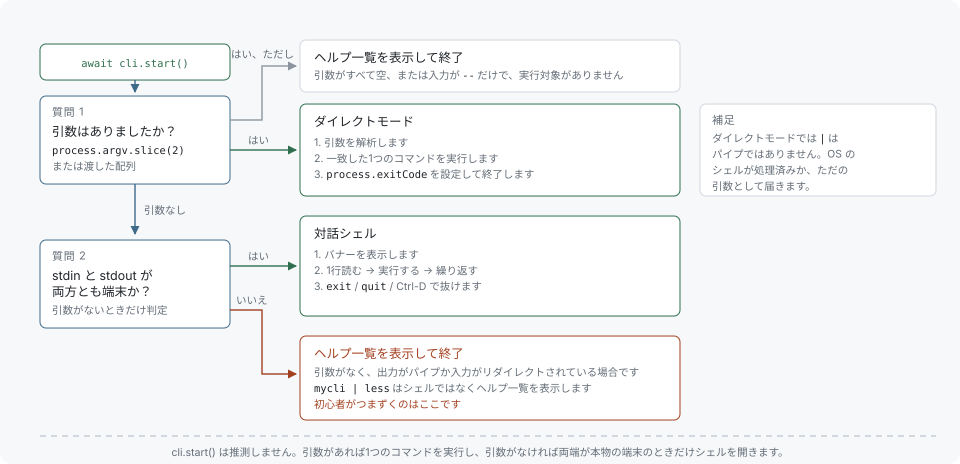

# 入門

このページでは、空のディレクトリから、端末のプロンプトで打てるコマンドまでを作ります。JavaScript か TypeScript の知識は前提としますが、コマンドラインツールを作った経験は前提としません。初めて出てくる用語は[用語集](glossary.md)で定義しています。

## 動作要件

- **Node.js 22 以降。** インストール済みのバージョンは `node --version` で確認できます。
- **ESM プロジェクトであること。** このパッケージは ECMAScript モジュールとしてのみ公開しています。CommonJS プロジェクトからは、Node.js 22.12 以降なら `require()` で読み込めます。
- **TypeScript 5.4 以降。** 型宣言を使うプロジェクトが対象で、`@types/node` も必要です。

### ここでいう ESM

ECMAScript モジュール（ESM）は JavaScript 標準のモジュール形式で、`import` と `export` を使うファイルのことです。Node.js は古い形式である CommonJS もサポートしており、こちらは `require()` と `module.exports` を使います。1 つの Node プロジェクトは `.js` ファイルをどちらで書いているかを宣言する必要があり、その宣言が `package.json` の `"type"` フィールドです。

```json
{
  "type": "module"
}
```

`"type": "module"` を指定すると、プロジェクト内のすべての `.js` ファイルが ECMAScript モジュールとして扱われます。指定しなければ Node は CommonJS とみなし、`import` 文は構文解析に失敗します。

このライブラリは ECMAScript モジュールしか公開しておらず、CommonJS 用の別ビルドもないため、`import` で使います。`.js` ファイルで `import` を使うには `"type": "module"` が必要です。Node.js 22.12 以降なら ES モジュールを `require("@libraz/node-cli")` で読み込めます。それ以前の 22.x では、CommonJS プロジェクトから動的インポートの `await import("@libraz/node-cli")` で到達できます。これはモジュールの Promise を返します。

## インストール

```bash
npm install @libraz/node-cli
```

```bash
yarn add @libraz/node-cli
```

```bash
pnpm add @libraz/node-cli
```

TypeScript プロジェクトでは Node の型定義も必要です。

```bash
npm install --save-dev typescript @types/node
```

## 最初のコマンド

`src/cli.ts` を作ります。

```typescript
#!/usr/bin/env node
import { createCLI } from "@libraz/node-cli";

const cli = createCLI({ name: "myapp", version: "1.0.0" });

cli
  .command("greet <name>")
  .description("Greet someone by name")
  .action((ctx) => {
    ctx.stdout.write(`Hello, ${ctx.args.name}!\n`);
  });

await cli.start();
```

各行の意味は次のとおりです。

- `#!/usr/bin/env node` は**シバン**です。次の節で説明します。
- `createCLI({ ... })` はアプリケーションオブジェクトを組み立てます。`name` は必須で、ヘルプ出力と履歴ファイルのパス（`~/.<name>_history`）の導出に使われます。先頭は英数字で、使える文字は英数字、`.`、`_`、`-` です。`version` は省略でき、`--version` が表示する値です。`version` がなければバージョンのフラグは定義されず、`--version` と `-V` は未知のオプションとして報告されます。設定はすべてこのオブジェクトで渡します。構築した後で変える手段はなく、名前や履歴の設定が不正ならこの時点で例外を投げます。
- `cli.command("greet <name>")` は、`name` という必須の位置引数を 1 つ取る `greet` というコマンドを宣言します。山括弧が必須を表し、`[name]` のように角括弧にすると省略可能になります。
- `.description(...)` は、生成されるヘルプでコマンドの横に並ぶ説明文を与えます。
- `.action((ctx) => { ... })` は、コマンドが呼び出されたときに走る関数を登録します。`ctx` は[コマンドコンテキスト](commands.md)です。`ctx.args` には名前をキーとした位置引数、`ctx.options` には解析済みのオプションが入り、`ctx.stdout` は結果を書き出すストリームです。
- `ctx.args.name` の型は `string` です。型は定義文字列から決まります。`<name>` は `string`、`[name]` は `string | undefined`、`<...name>` は `readonly string[]` です。位置引数は変換されないため、数値として使う場合はアクションの中で解析します。キーは camelCase で、`<file-name>` は `ctx.args.fileName` で読みます。
- `await cli.start()` で制御をライブラリに渡します。ライブラリは端末の引数を読み、実行モードを選び、一致したコマンドを実行して、終了コードで resolve します。

出力には `console.log` ではなく `ctx.stdout` を使ってください。`ctx.stdout` はその実行に紐づいたストリームです。だからこそ、対話シェルの中で出力を別のコマンドにパイプしても同じコマンドがそのまま動き、代わりのストリームを渡してテストすることもできます。

## プロジェクトの設定

### シバン行

`#!/usr/bin/env node` は、macOS と Linux で実行可能スクリプトの先頭に置く行です。ファイルを直接実行すると、OS はこの行を読み、名指しされたプログラムにそのファイルを引数として渡して起動します。ここでは `env node` が名指しされており、現在の `PATH` から `node` を探します。この行がないと、シェルは JavaScript をシェルコマンドとして解釈しようとします。

JavaScript から見るとこの行はコメントなので、import されるファイルに残っていても害はありません。TypeScript はコンパイル後の出力にもこの行を残します。Windows では無視され、代わりに npm がラッパースクリプトを生成します。

### `package.json` の `bin` エントリ

`bin` は、コマンド名とそれを実装するファイルを対応づけます。JavaScript ファイルが端末のプロンプトで単語として打てるものになるのは、この記述があるからです。

```json
{
  "name": "myapp",
  "version": "1.0.0",
  "type": "module",
  "bin": { "myapp": "dist/cli.js" },
  "scripts": {
    "build": "tsc"
  },
  "dependencies": {
    "@libraz/node-cli": "^2"
  },
  "devDependencies": {
    "@types/node": "^22",
    "typescript": "^7"
  }
}
```

パッケージをインストールすると、つまりグローバルインストールするか後述のようにリンクすると、npm は `PATH` の通ったディレクトリに `dist/cli.js` を指す `myapp` というエントリを作ります。以後 `myapp` と打てばそのファイルが実行されます。キー（`myapp`）がコマンド名で、パッケージ名と違っていてもかまいません。値はビルド後のファイルへのパスであり、TypeScript のソースではありません。

### `tsconfig.json`

```json
{
  "compilerOptions": {
    "target": "ES2023",
    "module": "Node16",
    "moduleResolution": "Node16",
    "outDir": "dist",
    "rootDir": "src",
    "strict": true,
    "types": ["node"]
  },
  "include": ["src"]
}
```

- `module` と `moduleResolution` を `Node16` にすると、TypeScript は ESM パッケージに対する Node と同じやり方で import を解決します。これによって `import { createCLI } from "@libraz/node-cli"` が公開されたエントリポイントに解決されます。
- `outDir` と `rootDir` は、`src/` の構成をそのまま写した形でコンパイル後の JavaScript を `dist/` に出します。`src/cli.ts` は `dist/cli.js` になり、これが `bin` に書いたパスです。
- `"types": ["node"]` は必須です。公開している型宣言は `node:stream` を import し、`AbortSignal` と `Symbol.dispose` のグローバルを使っており、いずれも `@types/node` が提供します。Node の型定義が読み込まれていないとこれらの参照が解決できず、名前が見つからないというエラーでビルドが失敗します。`@types/node` は Node 22 以降向けのものを入れてください。

### ビルド

```bash
npm run build
```

これで `src/cli.ts` が `dist/cli.js` にコンパイルされます。

### 実行権限を付ける

macOS と Linux では、OS がファイルを直接実行するには実行権限のビットが立っている必要があります。

```bash
chmod +x dist/cli.js
```

パッケージのインストール時、npm は `bin` に列挙されたファイルにこのビットを自動で立てます。そのため、この手順が要るのは主に開発中に `./dist/cli.js` を手で実行する場面です。Windows は権限ビットを使わないので、ここで必要な作業はありません。

### ローカル検証用にリンクする

プロジェクトのディレクトリで `npm link` を実行すると、グローバルなシンボリックリンクが張られ、レジストリからインストールした場合と同じように `bin` のエントリが解決されます。

```bash
npm link
```

これで `myapp` はシステムのどこからでも使えます。リンク先は作業コピーなので、変更を反映するにはビルドし直すだけで足ります。リンクを張り直す必要はありません。

リンクを外すには次のコマンドを使います。

```bash
npm unlink -g myapp
```

`npm unlink -g` に渡すのは `package.json` の**パッケージ名**であり、`bin` のコマンド名とは限りません。

## 実行する

`cli.start()` は、受け取った引数と、プロセスが端末につながっているかどうかで動作を決めます。



順番は次のとおりです。

1. 登録済みのプラグインの完了を待ちます。非同期のプラグインが reject された場合は致命的で、`cli.start()` がエラーを報告し（終了コード 1）、`exit` イベントが発火し、コマンドは実行されません。同期的に例外を投げたプラグインは、代わりに `cli.use()` から例外が送出されます。
2. 引数リストは `process.argv.slice(2)`、つまりコマンド名の後ろに打たれたものすべてです。ただし `cli.start()` に配列を明示的に渡した場合はそちらを使います。
3. 引数はあるが中身を持つものが 1 つもない場合（すべて空文字列、またはオプション終端マーカー `--` だけ）、ヘルプ一覧を表示して `cli.start()` は 0 で resolve します。
4. 引数が 1 つ以上あれば、そのコマンドを 1 回実行します。これが**直接実行モード**です。
5. 引数がなく、標準入力と標準出力がどちらも端末なら、**対話シェル**が開きます。
6. それ以外、つまり引数がなく出力がパイプされているか入力がリダイレクトされている場合は、ヘルプ一覧を表示して `cli.start()` は 0 で resolve します。プロンプトを出す端末がないため、プロンプトは開きません。

直接実行モードで失敗または中断したとき、ライブラリは `process.exit()` を呼ばずに `process.exitCode` を設定します。そのため未出力のデータが吐き出され、`exit` イベントのハンドラも走ります。直接実行モードのコマンドが成功した場合は、終了コードを変更しません。どちらの場合も `cli.start()` はプロセスが終了するときのコード（設定されていなければ 0）で resolve するので、呼び出し側は `process.exitCode` を見なくてもその値を読めます。例外は強制終了（2 回目の割り込み、終了コード 130）と、終了シグナルを受けた対話シェルのシャットダウン（終了コード 143）です。直接実行モードのコマンドを Ctrl-C で中断した場合の終了コードは 130 です。全一覧は[エラー](errors.md)にあります。

### 直接実行モード

```
$ myapp greet World
Hello, World!
```

知らないコマンドを指定すると、標準エラーに失敗を報告し、入力の誤りを表す終了コード 64 で終わります。

```
$ myapp greetings World
Error: Command not found: "greetings"
Available commands: greet, help
```

必須の引数が足りない場合も同じように報告され、そのコマンドの usage 行が添えられます。

```
$ myapp greet
Error: Missing required argument: <name>

  Usage: greet <name> [options]
```

### 対話シェル

端末で引数なしに起動すると、ツールは自身のプロンプトを開きます。

```
$ myapp
myapp v1.0.0
> greet World
Hello, World!
> help
myapp v1.0.0

Available commands:

  greet <name>         Greet someone by name
  help [...command]    Show help information

Options:
  -h, --help       Show help
  -V, --version    Show the CLI version

Shell commands: exit, quit
Type "help <command>" for more information.
> exit
$
```

1 行目が**バナー**です。既定ではアプリケーション名とバージョンになります。`createCLI` で `banner: ""` を指定すると表示されません。

シェルの中では、上下の矢印キーで過去の入力行をたどれます。入力行はセッションをまたいで `~/.myapp_history` に保存されます。Tab はコマンド名、サブコマンド、オプションのフラグ、オプションの値を補完します。`exit` と `quit` はセッションを終了します。これらは登録されたコマンドではなく、シェル自身が処理します。`help` は普通のコマンドなので、直接実行モードでも使えます。詳しくは[対話シェル](interactive-shell.md)にあります。

### 出力がパイプやリダイレクトのとき

引数がなく、出力先が端末以外の場合は、プロンプトを開かずヘルプ一覧を表示します。

```
$ myapp | less
myapp v1.0.0

Available commands:

  greet <name>         Greet someone by name
  help [...command]    Show help information

Options:
  -h, --help       Show help
  -V, --version    Show the CLI version

Type "help <command>" for more information.
```

これは意図した動作です。対話プロンプトをパイプに書き出しても、来ることのない入力を待って固まるだけだからです。`myapp > out.txt` の場合や、スクリプトや CI ジョブからツールを実行した場合も同じです。

## ツールを育てる

### 2 つ目のコマンド

コマンドを増やすには `cli.command(...)` をもう一度呼びます。位置引数のないコマンドは名前だけで足ります。

```typescript
cli
  .command("ping")
  .description("Check that the tool responds")
  .action((ctx) => {
    ctx.stdout.write("pong\n");
  });
```

```
$ myapp ping
pong
```

### オプション

**オプション**とは、`--uppercase` のように先頭にダッシュを付けて書く、順序を問わない名前付きの入力です。宣言には `.option()` を使い、フラグとスキーマを渡します。

```typescript
cli
  .command("greet <name>")
  .description("Greet someone by name")
  .option("-u, --uppercase", {
    type: "boolean",
    description: "Shout the greeting",
  })
  .action((ctx) => {
    const { name } = ctx.args;
    ctx.stdout.write(`Hello, ${ctx.options.uppercase ? name.toUpperCase() : name}!\n`);
  });
```

`"-u, --uppercase"` は、同じオプションの長形式と短いエイリアスを宣言します。`ctx.options` では値は常に長い名前を camelCase にしたキー、つまり `ctx.options.uppercase` の下にあり、エイリアス側には入りません。ダッシュを含む名前は連結され、`--dry-run` は `ctx.options.dryRun` で読みます。flags 文字列に長い名前が複数あるときは、最初のものがキーになります。

```
$ myapp greet World --uppercase
Hello, WORLD!
$ myapp greet World -u
Hello, WORLD!
$ myapp greet World
Hello, World!
```

真偽値のオプションは否定形も受け付けるので、`--no-uppercase` を渡すと `false` になります。オプションは値を取ることも、既定値を持つことも、選択肢のリストに制限することも、必須にすることもできます。[オプション](options.md)を参照してください。

### サブコマンド

コマンドビルダーに対して `.command()` を呼ぶと、新しいコマンドがその下に入れ子になります。自前のアクションを持たないグループは名前空間になります。

```typescript
const db = cli.command("db").description("Database commands");

db.command("migrate")
  .description("Apply pending migrations")
  .action((ctx) => {
    ctx.stdout.write("Migrations applied.\n");
  });
```

```
$ myapp db migrate
Migrations applied.
```

生成されるヘルプも入れ子をそのまま反映します。

```
$ myapp help db
Usage: db <command> [options]

Database commands

Options:
  -h, --help    Show help for this command

Commands:
  migrate    Apply pending migrations

Type "help db <command>" for more information.
```

グループコマンドは自前のアクションを持たないため、サブコマンドなしで `myapp db` を実行すると同じヘルプが表示されます。入れ子の規則とエイリアスは[コマンド](commands.md)にあります。

## 出力を整える

出力系のヘルパーは、同じパッケージからエクスポートされた普通の関数です。`CLI` インスタンスは不要で、どの Node スクリプトからでも使えます。

### ログ出力

`createLogger()` はログレベル付きのロガーを作ります。既定の出力先は標準エラーで、診断用の出力と、コマンドが標準出力に出すデータとを切り分けられます。そのため `myapp export > data.json` にはデータだけが入ります。

```typescript
import { createLogger } from "@libraz/node-cli";

const log = createLogger({ prefix: "myapp" });

log.info("Starting up");
log.success("Finished in 1.2s");
log.error("Could not reach the server");
```

```
ℹ [myapp] Starting up
✔ [myapp] Finished in 1.2s
✖ [myapp] Could not reach the server
```

ストリームが端末でないときは、記号が素のラベル（`[INFO]`、`[OK]`、`[ERROR]`）に置き換わり、ログファイルでも読める出力になります。ログレベル、タイムスタンプ、子ロガーは[ログ出力](logging.md)で扱います。

### テーブル

`table()` は整形済みの文字列を返します。自分では何も出力しません。

```typescript
import { table } from "@libraz/node-cli";

const rows = [
  { name: "alpha", status: "ready", size: 128 },
  { name: "beta", status: "pending", size: 4096 },
];

process.stdout.write(`${table(rows, { border: "rounded" })}\n`);
```

```
╭───────┬─────────┬──────╮
│ name  │ status  │ size │
├───────┼─────────┼──────┤
│ alpha │ ready   │ 128  │
│ beta  │ pending │ 4096 │
╰───────┴─────────┴──────╯
```

列の選択、揃え、幅、罫線のスタイルは[テーブル](table.md)で扱います。

## 次のステップ

- [コマンド](commands.md) — コマンド定義の完全な構文、エイリアス、検証、キャンセル。
- [オプション](options.md) — 型、既定値、選択肢、必須オプション、独自の解析。
- [対話シェル](interactive-shell.md) — 履歴、タブ補完、パイプ、モード。
- [カラー](color.md)、[テーブル](table.md)、[プログレス](progress.md)、[プロンプト](prompts.md)、[ログ出力](logging.md) — 出力ツールキット。
- [エラー](errors.md) — 失敗の報告のされ方と、それぞれが返す終了コード。
- [イベントとプラグイン](events-and-plugins.md) — ライフサイクルフックと、コマンド群のパッケージ化。
- [実例集](examples.md) — 動作する完全なプログラム。
- [API リファレンス](api-reference.md) — すべてのエクスポートと、そのシグネチャ。
