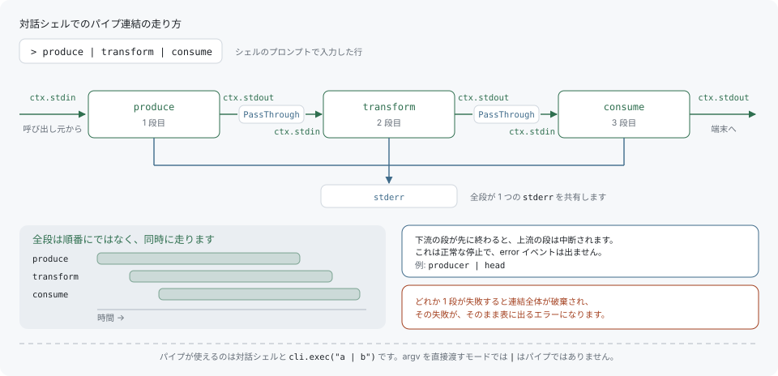
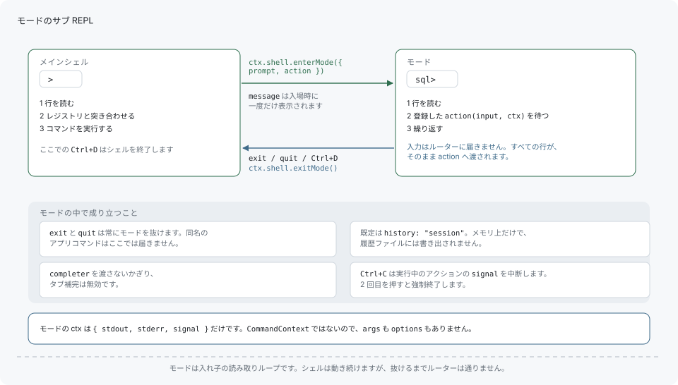

# 対話シェル

対話シェルは、コマンド行を 1 行ずつ読み取って実行し、結果を表示してまた入力を促すプロンプトです。この読み取り・実行・表示のループは一般に REPL と呼ばれます（[用語集](glossary.md)を参照）。プロンプトで使えるコマンドは、プログラムがコマンドラインで受け付けるコマンドとまったく同じです。二重に登録する必要はありません。

シェルは素のコマンド実行に 4 つの機能を足します。セッションをまたいで残るコマンド履歴、タブ補完、コマンド間のパイプ、モードサブ REPL です。

## シェルが起動する条件

`cli.start()` は 2 つのモードのどちらかを選びます。

- **直接実行モード** — コマンドライン引数が 1 つ以上渡された場合。引数は 1 つのコマンドとして実行され、プロセスは終了します。
- **対話シェル** — 引数が**1 つもない**こと、そして標準入力ストリームと標準出力ストリームが**どちらも端末である**ことが条件です。

端末（TTY）とは、実際に対話できるコンソールのことです。シェルのウィンドウからプログラムを起動したときは、入力も出力も端末になります。どちらか一方でもファイルや別のプログラムにつながっていれば、端末ではありません。

引数がなく、かつどちらかのストリームが端末でない場合、シェルは起動しません。ヘルプ一覧を表示して `start()` は戻ります。最初につまずきやすいのがこの挙動です。

```
mycli            # both streams are terminals -> interactive shell
mycli | less     # stdout is a pipe, not a terminal -> help index, no shell
mycli < script   # stdin is a file, not a terminal -> help index, no shell
mycli deploy     # an argument was given -> direct mode
```

ほかにも、何も実行せずヘルプ一覧を表示する入力が 2 つあります。空文字列だけからなる引数リストと、空でない要素がオプション終端マーカー `--` だけのリストです。

```typescript
import { createCLI } from "@libraz/node-cli";

const cli = createCLI({ name: "mycli", prompt: "mycli> " });

cli
  .command("status")
  .description("Show system status")
  .action((ctx) => {
    ctx.stdout.write("ok\n");
  });

await cli.start();
```

`start()` は `CLI` インスタンスごとに 1 度しか呼べません。2 度目の呼び出しは例外を投げます。

## バナーとプロンプト

バナーは、シェルの起動時に一度だけ表示される行です。`banner` オプションか `banner()` メソッドで設定します。設定しない場合はアプリケーション名が表示され、バージョンを設定してあれば続けて `v` とバージョンが付きます。空文字列を渡すと表示を抑止できます。

プロンプトは、入力行の前に表示されるテキストです。`prompt` オプションか `prompt()` メソッドで設定し、既定値は `"> "` です。

```typescript
const cli = createCLI({
  name: "mycli",
  prompt: "mycli> ",
  banner: "mycli — type help to get started",
});
```

実行中のコマンドは `ctx.shell` を通じてプロンプトを変更できます（[コマンドからシェルを操作する](#コマンドからシェルを操作する)を参照）。

## シェルの組み込みコマンド

シェル自身が処理する名前は `exit` と `quit` の 2 つだけです。どちらもセッションを終了します。組み込みの `clear` や `history` はありません。

`help` はシェルの組み込みコマンドではなく、通常どおり登録されたコマンドです。そのため直接実行モードでも使えます。

トップレベルでは、登録されたコマンドが組み込みコマンドより優先されます。`exit` という名前のコマンドを登録すると、セッションを終了する代わりにそのコマンドが実行されます。Ctrl+D を押せばセッションは終了します。

プロンプトで Ctrl+D（入力の終わりを示すキー操作）を押すとセッションが終了します。プロンプトで Ctrl+C を押すと、入力中の行がカーソルの前後ともに消去され、新しいプロンプトが表示されます。セッションは終了しません。

## コマンド履歴

受け付けたコマンド行は保存され、上下の矢印キーで呼び出せます。ファイルに書き出されるため、セッションをまたいで残ります。

### 履歴の保存先

ファイルの既定値は `~/.<name>_history` で、`<name>` はアプリケーション名です。`historySize` は保持する項目数の上限で、既定値は `1000` です。

```typescript
const cli = createCLI({
  name: "mycli",
  historyFile: "/var/lib/mycli/history",
  historySize: 5000,
});
```

### 記録される内容

行が履歴に追加されてディスクに書き込まれるのは、コマンドの実行**前**です。そのため、コマンドの途中で強制終了したセッションでも、受け付けた行は残ります。

ファイルに届かない行が 3 種類あります。

- 空行、または空白だけの行
- 直前の項目とまったく同じ行
- モードサブ REPL の中で入力された行（[モードサブ REPL](#モードサブ-repl)を参照）

すべての項目から制御文字が除去されます。除去は `historyFilter` の実行後に行われるため、フィルタが端末のエスケープシーケンスを紛れ込ませ、項目の呼び出し時に再生させることはできません。

### 機微な行の秘匿

`historyFilter` は、保存される前の各行を受け取ります。`null` を返すとその行は完全に破棄され、文字列を返すと元の行の代わりにその文字列が保存されます。引数として入力した秘密情報をファイルに残さないための仕組みです。

```typescript
const cli = createCLI({
  name: "mycli",
  historyFilter: (line) => {
    // Drop the whole line.
    if (line.startsWith("login ")) return null;
    // Or keep the line and replace just the secret.
    return line.replace(/(--token[ =])\S+/g, "$1***");
  },
});
```

このフィルタを設定すると、`deploy --token abcd1234` と入力しても `deploy --token ***` が保存されます。

### ファイルの安全性

履歴ファイルには入力された内容がそのまま入るため、非公開のファイルとして扱われます。

- ファイルモードは `0600`（所有者だけが読み書きできる状態）に保たれ、それ以外になっていれば `0600` に戻されます。
- シンボリックリンクを辿らずに開くため、そのパスに仕込まれたリンクは、書き込まれるのではなく拒否されます。
- 通常ファイルでない場合、または別のユーザーが所有している場合は拒否されます。

複数のセッションが同時に動いている場合は、履歴ファイルの隣に置かれる `.lock` ファイルで調停します。すでに存在しないプロセスが残したロックは即座に破棄されるため、クラッシュしたセッションが後続のセッションを止めることはありません。

通常の保存では新しい項目を追記します。ファイル全体を書き直すのは、サイズ上限を超えて古い項目を削る必要があるときだけです。

### 履歴を保存できない場合

権限の拒否、読み取り専用のファイルシステム、パスに置かれたシンボリックリンク、別のユーザーが所有するファイルといった環境に起因する失敗は、やり直しても解消しません。標準エラーストリームに一度だけ警告を出したあと、そのセッションの残りでは履歴の永続化を止めます。それ以外の失敗については、保存を試みるたびに警告します。

どちらの場合もシェルは動き続け、矢印キーによるセッション内の呼び出しも引き続き使えます。

## タブ補完

Tab を押すと、カーソル位置の単語に対する補完候補をシェルに問い合わせます。

### 補完コンテキスト

コマンドは `.completer(fn)` で独自の候補を提供します。`fn` は `Completer` 型に一致する関数です。

```typescript
type Completer = (ctx: CompletionContext) => string[] | Promise<string[]>;
```

`CompletionContext` が運ぶ情報は次のとおりです。

| フィールド | 意味 |
|---|---|
| `line` | **アクティブなパイプセグメント** — 行全体ではなく、カーソルのある部分 |
| `fullLine` | 入力行の全体。前段のパイプセグメントも含みます |
| `current` | 補完対象の単語 |
| `commandPath` | 解決済みのコマンドパス。エイリアスは正規名に置き換え済み |
| `args` | ここまでに解析した位置引数 |
| `options` | ここまでに解析したオプション。**未加工で型変換前**の値で、既定値の適用も検証も行われていません |
| `iteration` | 行を変更しないまま Tab を連続で押した回数。`1` から始まり、編集するとリセットされます |
| `signal` | 補完の制限時間を超えたときに中止される `AbortSignal`（[用語集](glossary.md)を参照） |

返された候補は、表示される前に `current` で絞り込まれます。補完関数は、あらかじめ絞り込んだテキストではなく候補の完全な値を返してください。

### 解決の順序

シェルは次の順に試し、最初に候補が得られたものを使います。

1. **トップレベルのコマンド名**とそのエイリアス。`--help` と `-h` は常に含まれます。バージョンを設定してあれば `--version` と `-V` も含まれます。`exit` と `quit` は、同名の登録コマンドに隠されていないかぎり含まれます。
2. **サブコマンド名** — ここまでに一致したコマンドのもの。
3. **インラインのオプション値** — `--opt=value` や `-o=value` の `=` より後ろの部分。
4. **直前のオプションの値** — `--region <Tab>` のように、値を取るフラグの次に来る単語。
5. **オプションフラグ** — 一致したコマンドのもの。ブールオプションの `--no-` 形式も含みます。
6. **コマンド自身の補完関数** — `.completer()` で登録したもの。

隠しオプションが候補になることはありません。隠しサブコマンドも同じで、親コマンドの位置引数が先に消費してしまうために到達できないサブコマンドも候補になりません。

オプション終端マーカー `--` より後ろでは、オプションのフラグもオプションの値も提示しません。そこから先はすべて、文字どおりの位置引数の値だからです。コマンド自身の補完関数はそこでも実行されます。

補完はアクティブなパイプセグメントを対象とします。`ls | gre<Tab>` では、`ls` の引数ではなく 2 段目のコマンド名を補完します。

### オプション値の補完

オプション値の候補は `autocomplete` 設定から得られます。配列でも、同期・非同期どちらの関数でも構いません。`autocomplete` がない場合は、そのオプションの `choices` を文字列に変換して使います。

```typescript
async function loadProfileNames(): Promise<string[]> {
  return ["default", "staging", "production"];
}

cli
  .command("deploy <env>")
  .option("--region <region>", {
    autocomplete: ["us-east-1", "us-west-2", "eu-west-1"],
  })
  .option("--profile <profile>", {
    autocomplete: async (current) => {
      const names = await loadProfileNames();
      return names.filter((name) => name.startsWith(current));
    },
  })
  .action((ctx) => {
    ctx.stdout.write(`Deploying to ${String(ctx.args.env)}\n`);
  });
```

オプションスキーマの残りについては[オプション](options.md)を参照してください。

### 独自の補完関数

```typescript
async function loadKnownHosts(): Promise<string[]> {
  return ["db-1.internal", "db-2.internal", "web-1.internal", "web-2.internal"];
}

cli
  .command("connect <host>")
  .option("--port <port>", { type: "number" })
  .completer(async (ctx) => {
    // The framework already offers flags; only host names are left to add.
    if (ctx.current.startsWith("-")) return [];
    const hosts = await loadKnownHosts();
    // First Tab: the two most common hosts. Second Tab and beyond: all of them.
    return ctx.iteration === 1 ? hosts.slice(0, 2) : hosts;
  })
  .action((ctx) => {
    ctx.stdout.write(`Connecting to ${String(ctx.args.host)}\n`);
  });
```

この 2 段階の動きを支えているのが `iteration` フィールドです。行を変更しないまま Tab を連続で押した回数を数え、行を編集した時点でリセットされます。

### タイムアウトと失敗

非同期の補完プロバイダには 1000 ms の上限があります。上限に達すると、補完コンテキストで渡した `signal` が中止され、プロバイダは自分の処理を止められます。このとき候補は空のリストになります。例外を投げた場合や、返したプロミスが失敗した場合も候補は空になります。補完がエラーを利用者に見せることはなく、プロンプトが固まることもありません。

候補は挿入前にエスケープされます。空白、引用符、バックスラッシュ、パイプ記号を含む候補でも、読み直したときに 1 つの引数として扱われます。閉じられていない引用符の途中で終わっている行は、内部で引用符を閉じてから解析します。

## パイプ

`|` で区切った 2 つ以上のコマンドはパイプチェーンを構成し、各ステージの出力が次のステージの入力になります。

```
mycli> produce | transform | consume
```



### パイプチェーンの動き

ステージ同士はメモリ上のストリームでつながり、**並行して**動きます。1 段目が終わってから 2 段目が始まるのではなく、データは生成されたそばから流れていきます。

- *i* 段目の `ctx.stdout` が *i+1* 段目の `ctx.stdin` になります。
- 最初のステージの `ctx.stdin` は呼び出し元の入力です。
- 最後のステージの `ctx.stdout` は呼び出し元の出力です。
- `ctx.stderr` はすべてのステージで同じストリームです。

### パイプ入力の読み取り

`ctx.stdin` は読み取り可能なストリームで、入力がない場合は `null` です。

```typescript
cli
  .command("uppercase")
  .description("Read text and write it in upper case")
  .action(async (ctx) => {
    if (!ctx.stdin) {
      ctx.stderr.write("uppercase expects piped input\n");
      return;
    }
    for await (const chunk of ctx.stdin) {
      ctx.stdout.write(String(chunk).toUpperCase());
    }
  });
```

シェルのプロンプトでパイプを**使わずに**入力したコマンドでは、`ctx.stdin` は `null` になります。シェルはコマンドを実行する前に端末の入力を手放すため、コマンドが読むものは残っていません。アクションの中で利用者に質問するときは、`ctx.stdin` を読むのではなく[プロンプト](prompts.md)で説明しているプロンプト関数を使ってください。

### 途中での打ち切り

上流のステージがまだ出力を作っている途中で下流のステージが終わった場合、上流のステージは内部の停止マーカーでキャンセルされます。その `ctx.signal` は中断されますが、キャンセルハンドラは実行されません。これは**正常な**打ち切りです。チェーンは失敗扱いにならず、`commandError` イベントも `error` イベントも発生しません（[イベントとプラグイン](events-and-plugins.md)を参照）。システムシェルが `producer | head` に対して行うことと同じです。

### ステージが失敗した場合

いずれかのステージが例外を投げると、チェーン全体が下流の消費側と上流の生成側の両方向へ破棄されます。相手を失ったまま待ち続けるステージは残りません。呼び出し元が目にするのは、最初に起きたその失敗です。

### パイプは文字列入力にだけ適用されます

パイプの分割はコマンド**文字列**に対して行われます。対象になるのは対話シェルと `cli.exec("a | b")` です（[イベントとプラグイン](events-and-plugins.md)を参照）。

直接実行モードでは、引数はすでに単語へ分割された配列として渡されるため、パイプの分割は一切行いません。そこでの `|` はパイプではなく、ただの引数値です。（実際には、プログラムが目にする前にシステムシェルが `|` を処理します。）

### 未対応の構文

リダイレクト演算子は `ParseError` で拒否されます。

```
Error: Redirection operator "<" is not supported
```

空のパイプセグメント（`a || b`）と末尾のパイプ（`a |`）も `ParseError` になります。[エラー](errors.md)を参照してください。

## モードサブ REPL

モードは、独自のハンドラを持つ入れ子のプロンプトです。モードが有効な間は、入力した行がそのままハンドラに渡り、コマンドのルーティングは完全に迂回されます。SQL コンソール、チャットセッション、電卓は、いずれもモードに向いた題材です。



### モードに入る

コマンドは `ctx.shell` を通じてモードに入ります。

```typescript
async function runQuery(sql: string, options: { signal: AbortSignal }): Promise<unknown[]> {
  options.signal.throwIfAborted();
  return [{ id: 1, name: "alice" }];
}

cli
  .command("sql")
  .description("Open an interactive SQL session")
  .action((ctx) => {
    if (!ctx.shell) {
      ctx.stderr.write("sql is only available in the interactive shell\n");
      return;
    }
    ctx.shell.enterMode({
      prompt: "sql> ",
      banner: 'Entering SQL mode. Type "exit" to return.',
      history: "session",
      completer: ({ current }) => {
        const keywords = ["SELECT", "FROM", "WHERE", "ORDER BY", "LIMIT"];
        return keywords.filter((k) => k.startsWith(current.toUpperCase()));
      },
      action: async (input, { stdout, stderr, signal }) => {
        try {
          const rows = await runQuery(input, { signal });
          stdout.write(`${JSON.stringify(rows)}\n`);
        } catch (err) {
          stderr.write(`${err instanceof Error ? err.message : String(err)}\n`);
        }
      },
    });
  });
```

コマンドが対話シェル以外で動いているときは、`cli.exec()` の場合も含めて `ctx.shell` が `null` になります。必ずガードしてください。

### モードの設定

`ModeConfig` のフィールドは次のとおりです。

| フィールド | 必須 | 意味 |
|---|---|---|
| `prompt` | はい | モードが有効な間に表示するプロンプト |
| `action` | はい | 入力行と小さなコンテキストを受け取って呼ばれます |
| `banner` | いいえ | モードに入ったときに一度だけ表示される文字列 |
| `completer` | いいえ | モード内でのタブ補完。**省略すると、モード内で Tab を押しても何も起きません** |
| `history` | いいえ | `"session"`（既定）または `"none"` |

モードの `completer` はコマンドと同じ `Completer` です。`CompletionContext` を受け取り、候補を同期で、またはプロミスで返します。`line` と `fullLine` は入力行、`current` は最後の単語（空白の直後なら `""`）、`commandPath` は `[]`、`args` と `options` は空です。`iteration` と `signal` はコマンドの場合と同じです。候補は `current` では絞り込まれないため、completer が一致するものだけを返してください。ほかのプロバイダと同じ 1000 ms の上限が適用され、例外を投げた場合や、返したプロミスが失敗した場合は候補が返りません。

`history: "session"` では呼び出し用の履歴をメモリ上だけに保持し、上限は `historySize`、連続する重複は記録しません。どちらの設定でも、モードでの入力が履歴ファイルに書き込まれることはありません。

### モード内での違い

- モードのアクションに渡されるコンテキストは `{ stdout, stderr, signal }` だけです。`CommandContext` **ではない**ため、`args` も `options` も `shell` も `stdin` もありません。
- すべての行がそのままアクションに届きます。解析もルーティングも、登録済みコマンドとの照合も行いません。
- `exit` と `quit` は常にモードを抜けます。同名の登録コマンドはモード内から到達できないため、そちらを優先すると利用者がモードから出られなくなります。
- Ctrl+D はモードを抜けてメインのプロンプトに戻ります。入力ストリームがすでに終わっている場合は、代わりにセッションを終了します。
- Ctrl+C は、実行中のアクションに渡された `signal` を中止します。もう一度押すとプロセスを強制終了します。

`exit`、`quit`、Ctrl+D のいずれかでモードを抜けると、メインのプロンプトに戻ります。コマンドから `ctx.shell?.exitMode()` を呼んで抜けることもできます。

## コマンドの中断

Ctrl+C は実行中のコマンドに中断を送ります。フレームワークはこれを 2 段階で処理します。

**1 回目の押下。** `ctx.signal` が中止され、`.cancel()` で登録したハンドラが実行され、標準エラーストリームに次の行が書き出されます。

```
Interrupted. Press Ctrl-C again to force quit.
```

シグナルを見張っているコマンドはここで停止し、シェルはプロンプトに戻ります。

**2 回目の押下** は、250 ms の猶予時間を過ぎてから効きます。端末のカーソルが復元され、`exit` イベントのリスナがすべて実行され（上限は 2000 ms なので、終わらないリスナが終了処理を止めることはありません）、プロセスはステータス 130 で終了します。猶予時間があるおかげで、じれて素早く 2 回押しただけでは、まじめにキャンセル処理を進めているコマンドを強制的に終わらせずに済みます。

キャンセルすべき対象がないときに届いた Ctrl+C は、その場で強制終了します。

```typescript
cli
  .command("sync")
  .cancel((ctx) => {
    ctx.stderr.write("\nRolling back...\n");
  })
  .action(async (ctx) => {
    const res = await fetch("https://example.com/data", { signal: ctx.signal });
    ctx.stdout.write(await res.text());
  });
```

シェルは SIGTERM も処理します。SIGTERM は、プロセスマネージャがプログラムに停止を求めるときに送るシグナルです。キャンセルが要求され（実行中のコマンドやモードのアクションの `ctx.signal` が中断されます）、200 ms の猶予をおいて履歴が保存され、`exit` イベントが発生し（強制終了と同じく上限は 2000 ms です）、プロセスはステータス 143 で終了します。SIGHUP は処理しないため、Node の既定の動作でプロセスが終わります。

終了コードの一覧は[エラー](errors.md)にあります。

## コマンドからシェルを操作する

`ctx.shell` は、コマンドが自分の動いているセッションに手を加えるためのハンドルです。`Shell` は**型としてのみ**エクスポートされます。自分で構築することはできず、フレームワークが生成します。

| メソッド | 効果 |
|---|---|
| `stop()` | 現在のコマンドが戻ったあとにセッションを終了します |
| `setPrompt(text)` | プロンプトのテキストを置き換え、シェルを返します |
| `enterMode(config)` | モードサブ REPL に入ります |
| `exitMode()` | 現在のモードを抜けます |

`setPrompt` は即座に反映されます。モードが有効なときだけは例外で、`exitMode()` のあとに反映されます。

```typescript
cli
  .command("use <project>")
  .description("Switch the active project")
  .action((ctx) => {
    const project = String(ctx.args.project);
    ctx.shell?.setPrompt(`${project}> `);
    ctx.stdout.write(`Switched to ${project}\n`);
  });

cli
  .command("logout")
  .description("End the session")
  .action((ctx) => {
    ctx.stdout.write("Goodbye\n");
    ctx.shell?.stop();
  });
```

## 関連ページ

- [コマンド](commands.md) — コマンド、引数、サブコマンド、キャンセルハンドラの定義
- [オプション](options.md) — オプションフラグ、型、`choices`、`autocomplete`
- [プロンプト](prompts.md) — アクションの中から利用者に質問する
- [イベントとプラグイン](events-and-plugins.md) — ライフサイクルイベント、プラグイン、`cli.exec()`
- [エラー](errors.md) — エラークラスと終了コード
