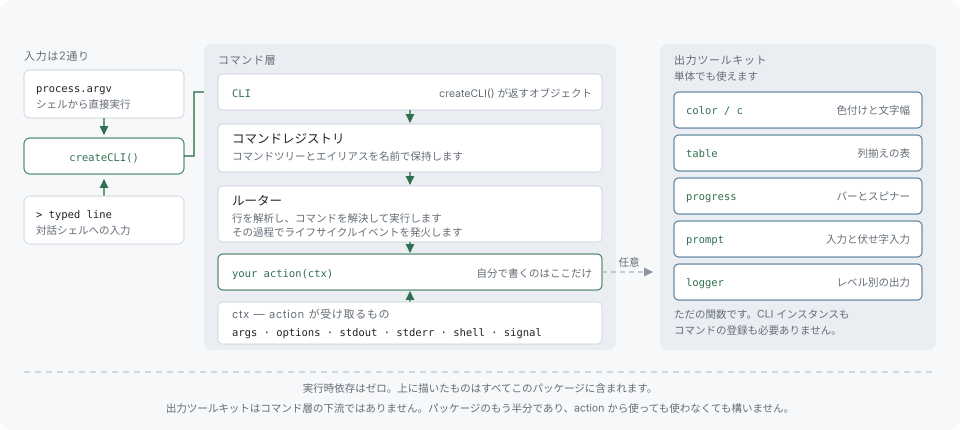

# はじめに

`@libraz/node-cli` は、Node.js と TypeScript でコマンドラインツールを作るためのフレームワークです。引数を解析してコマンドハンドラに振り分け、ヘルプを生成し、同じコマンド定義からツール自身の対話プロンプトを開くこともできます。色付け、テーブル、進捗表示、対話的な質問、ログ出力をまとめた出力ツールキットも同梱しています。実行時依存はありません。インストールしても依存ツリーに加わるのは 1 パッケージだけで、サブツリーが丸ごと付いてくることはありません。

## 想定する読者

対象は、端末から呼び出すツールを書く人です。ビルドスクリプト、デプロイ補助、データベースコンソール、プロジェクトの雛形生成など、用途は問いません。コマンドラインツールを作った経験は前提としません。[入門](getting-started.md)では、空のディレクトリからインストール済みのコマンドまでを順に追います。

## アーキテクチャ



図は 3 つの部分に分かれます。

**アプリケーションオブジェクト。** `createCLI()` はアプリケーションオブジェクトを返します。名前、バージョン、説明、プロンプト文字列、バナー、履歴の設定はすべて `createCLI()` に渡し、以後は変更できません。このオブジェクトは、すべてのコマンドが登録されるレジストリを所有します。ライブラリに制御を渡す唯一の地点が `cli.start()` です。

**コマンド層。** `cli.command(...)` の呼び出し 1 回が 1 つのコマンドを定義します。定義するのは、名前、位置引数、オプション、そして呼び出されたときに走る関数です。コマンドはサブコマンドとして入れ子にできるので、`myapp db migrate` は `db` グループ配下の `migrate` コマンドになります。すべてのコマンドとサブコマンドのヘルプはこの定義から生成されるため、別に usage 文字列を用意して同期させる必要はありません。[コマンド](commands.md)と[オプション](options.md)を参照してください。

**出力ツールキット。** `color`、`c`、`table`、`progress`、`prompt`、`createLogger` は、いずれも普通のエクスポートです。CLI オブジェクトを参照しませんし、CLI オブジェクトが存在している必要もありません。桁の揃ったテーブルを出したいだけのスクリプトなら、`table` だけを取り込めます。

```typescript
import { table } from "@libraz/node-cli";

const rows = [
  { name: "alpha", status: "ready" },
  { name: "beta", status: "pending" },
];

process.stdout.write(`${table(rows, { border: "rounded" })}\n`);
```

ツールキットのページは[カラー](color.md)、[テーブル](table.md)、[プログレス](progress.md)、[プロンプト](prompts.md)、[ログ出力](logging.md)です。

## 定義はひとつ、実行経路はふたつ

ライブラリの残りの部分は、この設計方針から導かれます。コマンドの定義は 1 回だけ書き、その同じ定義に 2 通りの経路で到達します。端末のコマンドラインに渡す引数としての経路と、ツール自身のプロンプトに打ち込む 1 行としての経路です。

```typescript
#!/usr/bin/env node
import { createCLI } from "@libraz/node-cli";

const cli = createCLI({ name: "myapp", version: "1.0.0" });

cli
  .command("greet <name>")
  .description("Greet someone by name")
  .action((ctx) => {
    ctx.stdout.write(`Hello, ${ctx.args.name}!\n`);
  });

await cli.start();
```

引数付きで実行すると、コマンドが 1 回走ってプロセスが終了します。

```
$ myapp greet World
Hello, World!
```

端末で引数なしに実行すると、ツールは自身のプロンプトを開き、同じコマンドを入力行として打ち込む形になります。

```
$ myapp
myapp v1.0.0
> greet World
Hello, World!
> exit
```

前者を *直接実行モード*、後者を *対話シェル* と呼びます。どちらで動くかは `cli.start()` が自動的に選びます。選択の規則は[入門](getting-started.md)に、シェル固有の機能は[対話シェル](interactive-shell.md)にあります。

## 収録している機能

| 機能 | 概要 |
| --- | --- |
| コマンドとサブコマンド | エイリアス、非表示コマンド、コマンドごとの検証に対応した入れ子のコマンドツリー。 |
| 位置引数 | コマンド定義文字列で宣言する、必須・省略可能・可変長（複数値）の引数。`ctx.args` と `ctx.options` は定義から型付けされます。 |
| オプション | 長短 2 通りの書式、数値や真偽値への型変換、既定値、必須指定、選択肢による制限、独自の解析と検証。 |
| ヘルプ生成 | 定義から組み立てられる、コマンド一覧とコマンドごとのページ。 |
| 対話シェル | ツールの内側に開くプロンプト。永続化される履歴、秘匿値を除外する履歴フィルタ、タブ補完つき。 |
| パイプ | シェルの中で、あるコマンドの出力を別のコマンドの入力に流し込めます。 |
| モード | コマンドがシェルを、独自のハンドラと補完を持つサブプロンプトに引き渡せます。 |
| カラー | 名前付きスタイル、スタイルの連結、タグ付きテンプレート記法、出力先が端末でないときの自動無効化。 |
| テーブル | 罫線プリセット、列ごとの幅と揃え、東アジア文字や絵文字でも正しく求まる表示幅による桁揃え。 |
| プログレス | プログレスバー、複数バーのグループ、スピナー。 |
| プロンプト | テキスト、確認、単一選択、複数選択、伏せ字のパスワード入力。 |
| ログ出力 | ログレベル付きの出力。プレフィックス、タイムスタンプ、子ロガー、ストリームのバックプレッシャー処理つき。 |
| イベント | 実行の前後、エラー時、終了時に発火するフック。 |
| プラグイン | コンテキストを受け取り、コマンド・イベント・フォールバックハンドラを登録する関数。 |

## 対象外のこと

- **実行時依存はなく、追加でインストールするプラグインのエコシステムもありません。** 上に挙げたものはすべて 1 つのパッケージに入っています。挙がっていないものは自分で書く必要があります。
- **ESM 専用。** 公開しているのは ECMAScript モジュールだけです。読み込みは `import` で行います。CommonJS 用の別ビルドはなく、Node.js 22.12 以降なら `require("@libraz/node-cli")` で読み込めます。それ以前の 22.x では `await import("@libraz/node-cli")` を使ってください。[ESM](glossary.md#esmecmascript-モジュール) を参照してください。
- **Node 22 以降。** それより古い Node は対象外です。
- **設定ファイルの読み込みは行いません。** ライブラリは `.myapprc` も `myapp.config.js` も探しませんし、環境変数による上書きも見ません。設定の読み込みはアプリケーション側の仕事です。
- **外部シェル向けの補完スクリプトは生成しません。** タブ補完が効くのは対話シェルの中です。bash・zsh・fish 用の補完スクリプトは生成しないため、システムシェルのプロンプトで Tab を押すと、ツールのコマンドではなくファイル名が補完されます。
- **組み込みメッセージの翻訳はありません。** 生成されるヘルプ、エラーメッセージ、プロンプトのラベルは英語です。アプリケーション側が与えた文字列はそのまま使われるので、コマンドの説明はどの言語でも書けます。
- **位置引数の型変換は行いません。** オプションは数値や真偽値として宣言できますが、位置引数は常に文字列です（可変長の場合は文字列の配列）。変換はアクションハンドラの仕事です。
- **既定コマンドはありません。** 呼び出しでは必ずコマンドを名指しします。最初の引数がどれにも一致しなかったときに走るハンドラはありません。一致しなかった入力は[フォールバックハンドラ](events-and-plugins.md)で拾えますが、そこには解析済みの引数は渡りません。
- **テーブルのセル内での折り返しは行いません。** 列幅を超えたセルは、2 行目に折り返さず省略記号で切り詰めます。

## 次に読むページ

- [入門](getting-started.md) — 空のディレクトリからインストール済みのコマンドまで。プロジェクトのファイルを 1 つずつ説明します。
- [コマンド](commands.md) — コマンド定義文字列、引数、サブコマンド、エイリアス、検証、キャンセル。
- [オプション](options.md) — オプションスキーマ。型、既定値、エイリアス、選択肢、独自の解析と検証。
- [対話シェル](interactive-shell.md) — プロンプト、履歴、タブ補完、パイプ、モード。
- [カラー](color.md) — `color` プロキシ、`c` テンプレートタグ、端末幅のヘルパー。
- [テーブル](table.md) — 桁の揃った表形式の出力。
- [プログレス](progress.md) — プログレスバー、複数バーのグループ、スピナー。
- [プロンプト](prompts.md) — コマンドの中から利用者に質問する方法。
- [ログ出力](logging.md) — 標準エラーへのログレベル付き出力。
- [イベントとプラグイン](events-and-plugins.md) — ライフサイクルイベント、フォールバックハンドラ、コマンド群のプラグイン化。
- [エラー](errors.md) — エラークラス、失敗の報告のされ方、それぞれが返す終了コード。
- [実例集](examples.md) — 動作する完全なプログラム。
- [API リファレンス](api-reference.md) — すべてのエクスポートと、その完全なシグネチャ。
- [用語集](glossary.md) — このドキュメントで使う用語。
