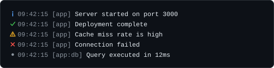

# ロギング

`logger(options?)` はレベル付きのロガーを作ります。アイコンと、必要ならタイムスタンプと接頭辞を添えた1行を書き出すメソッドが5つあります。パッケージが公開する素の関数なので `CLI` インスタンスは要らず、どの Node スクリプトからでも import できます。



## 最初の例

```ts
import { logger } from "@libraz/node-cli";

const log = logger({ prefix: "app", timestamp: true, level: "debug" });

log.info("Server started on port %d", 3000);
log.success("Deployment complete");
log.warn("Cache miss rate is high");
log.error("Connection failed");

const db = log.child("db");
db.debug("Query executed in 12ms");
```

## 出力の行き先

**どのレベルも1つのストリームへ書き、そのストリームの既定値は `process.stderr` です。** 重大度による振り分けはありません。`info` と `success` も、`warn` や `error` とまったく同じように stderr へ向かいます。

理由は、stdout がコマンドの *データ* を運ぶ経路だからです。`mycli list --json > out.json` を実行した人は、`out.json` に JSON だけが入っていることを期待します。診断情報が stdout に混ざればそれが壊れます。診断情報をすべて stderr に置けば、端末では見えたまま、リダイレクト先のファイルはきれいなままです。

ログの出力先を stdout にしたい場合は、明示的に指定します。

```ts
import { logger } from "@libraz/node-cli";

const log = logger({ stream: process.stdout });
```

## オプション

`LoggerOptions`:

| フィールド | 型 | 既定値 | 挙動 |
| --- | --- | --- | --- |
| `level` | `LogLevel` | `"info"` | 出力する最小のレベル。 |
| `prefix` | `string` | — | メッセージの前に `[prefix]` の形で描画されます。 |
| `timestamp` | `boolean` | `false` | ローカル時刻を `HH:MM:SS` で付けます。 |
| `stream` | `Writable` | `process.stderr` | すべてのレベルの出力先。 |
| `bufferLimit` | `number` | `1000` | ストリームが詰まっている間に待機させる行数。非負の安全な整数である必要があり、そうでなければ `RangeError` を投げます。 |

## レベル

```ts
type LogLevel = "debug" | "info" | "warn" | "error" | "silent";
```

順序は `debug < info < warn < error < silent` です。メッセージは、自身のレベルが設定されたレベル以上のときに出力されます。そのため `level: "warn"` では警告とエラーが出て、それより下はすべて落ちます。`level: "silent"` はすべての出力を抑制します。

## メソッド

`Logger`:

| メソッド | シグネチャ |
| --- | --- |
| `debug` | `(message: string, ...args: unknown[]) => void` |
| `info` | `(message: string, ...args: unknown[]) => void` |
| `success` | `(message: string, ...args: unknown[]) => void` |
| `warn` | `(message: string, ...args: unknown[]) => void` |
| `error` | `(message: string, ...args: unknown[]) => void` |
| `setLevel` | `(level: LogLevel) => void` |
| `child` | `(prefix: string) => Logger` |
| `flush` | `() => Promise<void>` |

`success` は独立したレベルではありません。**`info`** のレベルで絞り込まれ、`✔` の記号を付けて描画されます。そのため、レベルを `warn` に上げると `info` と一緒に消えます。

## フォーマット

追加の引数があるかどうかに関わらず、すべての呼び出しは Node の `util.format` を通ります。ここから2つの帰結が生まれます。

書式指定子が使えます。

```ts
import { logger } from "@libraz/node-cli";

const log = logger();

log.info("Listening on %s:%d", "127.0.0.1", 3000);
log.info("Config: %o", { retries: 3 });
log.info("Payload: %j", { ok: true });
```

`%s` は文字列、`%d` は数値、`%j` は JSON、`%o` は検査したオブジェクトを差し込みます。

同じ経路をたどるおかげで、第1引数が文字列でなくても呼び出しが壊れず、検査結果として描画されます。宣言上の引数の型は `string` なので TypeScript は文字列を要求しますが、そこを強制するもののない素の JavaScript からもロガーは呼べます。そこへ `Error` やオブジェクトが渡された場合、ログの呼び出しの中で例外になるのではなく、`util.format` が描画します（エラーならメッセージとスタック、オブジェクトなら検査した表示）。

続いてメッセージのテキストが無害化されます。**改行は残る** ため、複数行のスタックトレースは複数行のまま描画されます。タブと復帰は空白1つになり、それ以外の制御バイトは破棄されます。これにより、信頼できない入力から来たメッセージがカーソルを動かしたり画面を消したりできなくなります。

## 行の構成

1行は4つの部分を空白1つでつないで組み立てます。指定のない部分は省かれます。

順に `icon`、`timestamp`、`[prefix]`、`message` です。タイムスタンプは裸で表示され、角括弧で囲まれるのは接頭辞だけです。

```text
ℹ 09:42:15 [app] Server started on port 3000
```

アイコンは、出力先のストリームでカラーが有効かどうかで変わります。その判定については[カラー](color.md)を参照してください。

| レベル | カラーあり | カラーなし |
| --- | --- | --- |
| `debug` | `●` dim | `[DEBUG]` |
| `info` | `ℹ` blue | `[INFO]` |
| `success` | `✔` green | `[OK]` |
| `warn` | `⚠` yellow | `[WARN]` |
| `error` | `✖` red | `[ERROR]` |

そのため、出力をファイルへリダイレクトすると、エスケープシーケンスを含まない `[WARN]` のような素のラベルが残り、grep しやすくなります。

## 子ロガー

`child(prefix)` は、サブシステムに絞ったロガーを返します。接頭辞は `:` でつながります。

```ts
import { logger } from "@libraz/node-cli";

const log = logger({ prefix: "app" });
const db = log.child("db"); // prefix "app:db"
const pool = db.child("pool"); // prefix "app:db:pool"
```

子は `timestamp`、`stream`、`bufferLimit` を親から引き継ぎます。レベルの継承は **動的** です。後から `parent.setLevel("debug")` を呼ぶと、自分でレベルを設定していないすべての子に届きます。`child.setLevel(...)` はその子だけを上書きし、他には影響しません。

```ts
import { logger } from "@libraz/node-cli";

const log = logger({ prefix: "app" });
const db = log.child("db");

log.setLevel("debug"); // db now logs debug too
db.setLevel("error"); // db logs only errors; log is unaffected
log.setLevel("info"); // db keeps its own "error"
```

## プログレスインジケーターとの関係

バーやスピナーが描画中のストリームにログ行を書いても、フレームの途中に割り込むことはありません。インジケーターがいったん退き、きれいな行にログが書かれ、その下でインジケーターが自分を描き直します。[プログレス](progress.md)を参照してください。

この協調が効くのは、ロガーを通した出力だけです。生の `stream.write` はこれを迂回し、描画中のフレームを壊します。

## バックプレッシャーと `flush`

ストリームが一度に受け取れる量には限りがあり、いっぱいになると以降の書き込みは待たされます。この待たされている状態が **バックプレッシャー** です。その間、ロガーは `bufferLimit` を上限にメモリ上へ行を積み、待ち行列がいっぱいになると、新しい行の場所を空けるために最も **古い** 行を捨てます。`bufferLimit: 0` の場合、バックプレッシャー中に届いた行はその場で捨てられます。

ストリームがエラーを発した場合や、待ち行列を掃き出す前に閉じた場合は、バッファ上の行は破棄され、`flush()` は失敗します。

`flush()` は、バッファ上の行がストリームに届いた時点で解決します。すべての子ロガーも待つため、1回の呼び出しでツリー全体を賄えます。

```ts
import { logger } from "@libraz/node-cli";

const log = logger();

log.info("done");
await log.flush();
process.exit(0);
```

終了前に `flush()` を待つことで、書き込みの途中でプロセスが終わって最後の数行が失われる事態を防げます。

## よくある落とし穴

- **既定のストリームは、どのレベルでも stderr です。** `mycli run > out.txt` としてもログは端末に出ます。取り込むには `2> log.txt` が要ります。
- **重大度による stdout / stderr の振り分けはありません。** すべてを stdout へ移すには `stream: process.stdout` を渡します。
- **`success` は `info` のレベルで絞り込まれます。** レベルを `warn` に上げると表示されなくなります。
- **`success` は `LogLevel` ではありません。** `setLevel` には渡せません。
- **子のレベルは、子が自分で設定するまで親に追随します。** 設定した後は、親の変更は届きません。
- **カラーがないとアイコンが変わります。** ログファイルに入るのは `ℹ` ではなく `[INFO]` です。
- **改行は残り、タブは残りません。** スタックトレースは複数行のままで、タブは空白になります。
- **バックプレッシャー下では行が落ちることがあります。** 古いものから捨てられ、失敗は `flush()` が報告します。

## 関連ページ

- [カラー](color.md) — ストリームごとのカラー有効判定。
- [プログレス](progress.md) — ロガーとストリームを共有するインジケーター。
- [コマンド](commands.md) — コマンドコンテキストで使えるストリーム。
- [エラー](errors.md) — 失敗の報告と終了コード。
