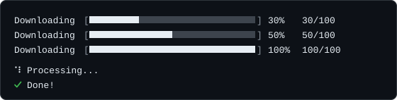

# プログレス

`progress` は、時間のかかる処理がまだ動いていることを示すインジケーターを作ります。合計が分かっている作業のためのプログレスバー、長さが分からない作業のためのスピナー、同時に走る複数の作業のためのマルチバーの3種類です。どのファクトリもパッケージが公開する素の関数なので、`CLI` インスタンスは要りません。



## 最初の例

```ts
import { progress } from "@libraz/node-cli";

const wait = (ms: number) => new Promise((resolve) => setTimeout(resolve, ms));

const bar = progress.bar({ total: 100, label: "Downloading" });
for (let done = 0; done <= 100; done += 10) {
  bar.update(done);
  await wait(100);
}
bar.finish();

const spinner = progress.spinner({ label: "Processing..." });
spinner.start();
await wait(1000);
spinner.succeed("Done!");
```

どちらのインジケーターもその場で描き直します。端末より幅の広い行は折り返され、再描画、ログ行、停止のたびに、その行が占めていたすべての行が消去されます。書き込み先は既定でどちらも **`process.stderr`** で、他のプログラムが読むかもしれない `process.stdout` を空けたままにします。

## オブジェクトの中身

`progress` は `bar`、`spinner`、`multi`、`releaseAll` の4つを持ちます。`releaseAll` は `restoreCursor` とともに、トップレベルでもエクスポートされています。

```ts
import { progress, releaseAll, restoreCursor } from "@libraz/node-cli";
```

`restoreCursor` はトップレベルのエクスポートだけです。`progress` の **メンバーではありません。**

## `progress.bar(options)`

合計が分かっている作業のためのバーを作ります。

### `BarOptions`

| フィールド | 型 | 既定値 | 挙動 |
| --- | --- | --- | --- |
| `total` | `number` | 必須 | ユニットの総数。有限でない値や負の値は `0` になり、合計が `0` のときは 100% として描画されます。 |
| `label` | `string` | `""` | バーの前に置くテキスト。空のときは行から省かれます。 |
| `width` | `number` | `30` | バーの幅（文字数）。小数は切り捨てられ、最低 1 セルになります。有限でない値、`0` 以下の値、`4096` を超える値は `RangeError` になります。 |
| `filled` | `string` | `"█"` | 完了した部分を描く文字。 |
| `empty` | `string` | `"░"` | 残っている部分を描く文字。 |
| `format` | `(state: BarState) => string` | — | 描画される行全体を差し替えます。 |
| `stream` | `Writable` | `process.stderr` | バーを描く先。 |
| `color` | `string` | — | バーの文字に適用するスタイル名。未知の名前は黙って無視されます。 |

既定の行は `` `${label}  [${bar}]  ${percent}%  ${current}/${total}` `` で、ラベルが空のときはラベルを落とします。

### `BarState`

再描画のたびに `format` へ渡されます。

| フィールド | 意味 |
| --- | --- |
| `current` | 完了したユニット数。 |
| `total` | 正規化後の合計。 |
| `percent` | 100 を上限に丸めた百分率。 |
| `elapsed` | バーを作ってからの経過時間（ミリ秒）。 |
| `eta` | 残り時間の推定値（ミリ秒）。完了後は `0`、速度が 0 の間は `Infinity` です。 |
| `rate` | 1秒あたりのユニット数。 |

```ts
import { progress } from "@libraz/node-cli";

const bar = progress.bar({
  total: 100,
  format: (state) => `${state.percent}% — ${Math.round(state.eta / 1000)}s left`,
});
```

### `Bar`

| メソッド | 挙動 |
| --- | --- |
| `update(current)` | 進捗の値を絶対値で設定します。 |
| `tick(delta = 1)` | 値を `delta` だけ進めます。 |
| `finish()` | `total` まで一気に進め、最後のフレームを描いて行を終えます。 |
| `stop()` | 完了させずに行を終えます。 |
| `[Symbol.dispose]()` | `stop()` と同じです。 |

`update` や `tick` に渡した有限でない値は無視され、どの値も `[0, total]` の範囲に丸められます。

## `progress.spinner(options?)`

所要時間が分からない作業のための、アニメーションするインジケーターを作ります。

### `SpinnerOptions`

| フィールド | 型 | 既定値 | 挙動 |
| --- | --- | --- | --- |
| `label` | `string` | `""` | アニメーションの横に置くテキスト。 |
| `frames` | `string[]` | `["⠋","⠙","⠹","⠸","⠼","⠴","⠦","⠧","⠇","⠏"]` | アニメーションのフレーム。空でない文字列の配列である必要があり、そうでなければ `RangeError` を投げます。 |
| `interval` | `number` | `80` | フレーム間のミリ秒。正の有限な値である必要があります。 |
| `stream` | `Writable` | `process.stderr` | スピナーを描く先。 |
| `color` | `string` | — | フレームの文字に適用するスタイル名。 |

既定のフレームは上に挙げた点字のドットです。ソースにはもう2種類のフレーム集合がありますが、エクスポートはされていません。使う場合は明示的に渡してください。

```ts
import { progress } from "@libraz/node-cli";

const lineSpinner = progress.spinner({ label: "Working", frames: ["-", "\\", "|", "/"] });
const arrowSpinner = progress.spinner({
  label: "Working",
  frames: ["←", "↖", "↑", "↗", "→", "↘", "↓", "↙"],
});
```

### `Spinner`

| メソッド | 挙動 |
| --- | --- |
| `start()` | アニメーションを開始します。 |
| `update(label)` | ラベルを差し替えます。次のフレームから反映されます。 |
| `succeed(message?)` | 停止して、緑の `✔` に続けてメッセージを書きます。 |
| `fail(message?)` | 停止して、赤の `✖` に続けてメッセージを書きます。 |
| `warn(message?)` | 停止して、黄の `⚠` に続けてメッセージを書きます。 |
| `stop()` | 停止して行を消し、何も書きません。 |
| `[Symbol.dispose]()` | `stop()` と同じです。 |

`succeed`、`fail`、`warn` は、メッセージを渡さなければスピナーの現在のラベルを使います。アニメーションのタイマー自体は Node プロセスを生かし続けないため、スピナーを動かしたままでも、作業を終えたプログラムは通常どおり終了します。

## `progress.multi()`

複数のバーを1つのブロックとして描くグループを作ります。**引数は取りません。** 各バーの設定は `add` で渡します。

```ts
import { progress } from "@libraz/node-cli";

const group = progress.multi();
const download = group.add({ total: 100, label: "download" });
const extract = group.add({ total: 100, label: "extract " });

download.update(60);
extract.update(25);

group.finish();
```

| メソッド | 挙動 |
| --- | --- |
| `add(options)` | バーを追加し、`Bar` のハンドルを返します。 |
| `finish()` | すべてのバーを完了させ、ブロックを閉じます。 |
| `stop()` | 完了させずにブロックを閉じます。 |
| `[Symbol.dispose]()` | `stop()` と同じです。 |

グループの描画先は1つのストリームで、ストリームを指定した **最初の** `add()` で決まります（まだ何も描画していない場合に限ります）。後続のバーの `stream` と、最初のフレームを描画した後に追加したバーの `stream` は無視されます。1つの行ブロックを2つの出力先に分割できないためです。`finish()` や `stop()` の後に `add()` を呼ぶと、例外ではなく、どのメソッドも何もしない不活性なハンドルが返ります。グループが閉じた直後にバーを登録したワーカーがあっても、コマンドは失敗しません。

## `using` による自動的な後始末

`using` は JavaScript の宣言で、囲みブロックを抜けるときに後始末の処理を走らせます。通常の終了でも、途中の `return` でも、例外による離脱でも同じです。対象になるのは `[Symbol.dispose]()` メソッドを持つ値で、バー、スピナー、マルチバーのグループはいずれもこれを持ちます。利用にはランタイムと TypeScript の設定で明示的リソース管理が有効になっている必要があります。

```ts
import { copyFileSync } from "node:fs";
import { progress } from "@libraz/node-cli";

function copyAll(files: string[], target: string): void {
  using bar = progress.bar({ total: files.length, label: "Copying" });
  for (const file of files) {
    copyFileSync(file, `${target}/${file}`);
    bar.tick();
  }
}
```

`using` を使わずに書いた、まったく同じ内容のコードです。

```ts
import { copyFileSync } from "node:fs";
import { progress } from "@libraz/node-cli";

function copyAll(files: string[], target: string): void {
  const bar = progress.bar({ total: files.length, label: "Copying" });
  try {
    for (const file of files) {
      copyFileSync(file, `${target}/${file}`);
      bar.tick();
    }
  } finally {
    bar.stop();
  }
}
```

どちらの書き方でも、コピーが途中で例外を投げたときに行が閉じられ、カーソルが元に戻ることは保証されます。

## 端末がない場合の挙動

ここが最も混乱を招くところです。出力先のストリームが **端末** ではない場合、つまり出力をファイルへリダイレクトしたとき、他のプログラムへパイプしたとき、CI のランナーに取り込まれたときには、インジケーターの挙動が変わります。

- **バーは何も描きません。** フレームも最終行も出さず、`finish()` も何も書きません。プログレスバーしか出力していない実行は、空のログを残します。
- **スピナーはフレームを描きません。** `stop()` も何も書きません。ただし `succeed`、`fail`、`warn` は端末かどうかに関わらず、最終行を1行 **必ず** 書きます。あとに残る記録を作る手段はこれです。
- **カーソルを隠して元に戻すのは端末のときだけです。**

どちらの状況でも読めるログを残すには、節目を [`logger`](logging.md) で報告し、対話的な場合はバーに任せてください。

## 後始末とカーソルの復帰

バーやスピナーは描画中に端末のカーソルを隠し、終わるときに再び表示します。異常終了のときもそれが確実に行われるよう、2つの関数があります。

- `releaseAll()` は、まだ動いているインジケーターをすべて止め、カーソルを元に戻します。すべてのコマンドの実行後と、対話シェルのクラッシュハンドラから自動的に呼ばれます。
- `restoreCursor()` は、カーソルを隠しているすべてのストリームでカーソルを再表示します。何度呼んでも安全です。

## その他の挙動

- **1つのストリームにつき、単体のインジケーターは1つだけです。** 同じ端末ストリームで2つ目のバーやスピナーを開始すると `Another progress indicator is already rendering to this stream; use progress.multi() for concurrent bars` を投げます。2つのインジケーターは互いの行配置を知りようがないためです。端末でないストリームでは何も描かないので、このガードは働きません。
- **プログレスとログの出力はきれいに混ざります。** 同じストリームへ書く [`logger`](logging.md) は描画中のフレームを避けて書き、その後でインジケーターが自分を描き直します。共有の調停役を介して両者が協調しているためです。生の `stream.write` は協調しないので、描きかけのフレームの途中に割り込みます。

## よくある落とし穴

- **既定のストリームは `process.stdout` ではなく `process.stderr` です。** stdout をファイルへリダイレクトしてもバーは消えません。消えるのは stderr をリダイレクトしたときです。
- **`restoreCursor` は `progress` にはありません。** パッケージのルートから import してください。
- **ストリームが端末でないとき、バーは `finish()` を含めて何も書きません。**
- **`progress.multi()` は引数を取りません。** オプションは各 `add()` の呼び出しに渡します。
- **`eta` の単位はミリ秒であり、秒ではありません。** 実際に進捗が出るまでは `Infinity` です。
- **`width` の `0` は例外になりますが、`total` の `0` はなりません。** 後者は最初から完了しているバーとして描画されます。

## 関連ページ

- [ロギング](logging.md) — 動作中のインジケーターと共存するレベル付き出力。
- [カラー](color.md) — `color` が受け付けるスタイル名。
- [コマンド](commands.md) — `releaseAll` が自動的に走る場所。
- [エラー](errors.md) — キャンセル時とクラッシュ時の挙動。
