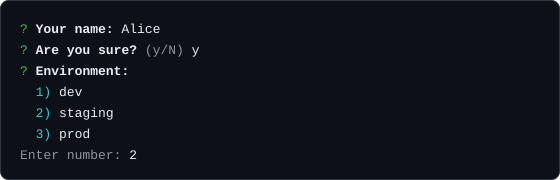

# プロンプト

`prompt` はキーボードの前にいる人に質問し、その答えで解決します。自由入力のテキスト、はい/いいえの確認、1つだけの選択肢、複数の選択肢、伏せ字のパスワードの5種類です。どのメソッドもパッケージが公開する素の非同期関数なので、`CLI` インスタンスは要りません。



## 最初の例

```ts
import { prompt } from "@libraz/node-cli";

const name = await prompt.text("Your name:");
const sure = await prompt.confirm("Are you sure?");
const env = await prompt.select("Environment:", ["dev", "staging", "prod"]);

console.log(name, sure, env);
```

1回の呼び出しで1つの答えを読み取り、受け入れられる入力が来るまで質問を繰り返します。質問は既定で `process.stdout` へ書き、答えは `process.stdin` から読みます。

## オブジェクトの中身

`prompt` は `text`、`confirm`、`select`、`multiselect`、`password` の5つを持ちます。`maskInput` は別のトップレベルのエクスポートです。

```ts
import { maskInput, prompt } from "@libraz/node-cli";
```

## 共通のオプション

どのメソッドも、`PromptBaseOptions<T>` を通じて次のオプションを受け取ります。

| フィールド | 型 | 既定値 | 挙動 |
| --- | --- | --- | --- |
| `validate` | `(value: T) => void` | — | 中で例外を投げると値を拒否します。 |
| `required` | `boolean` | メソッドごとに異なる | 空の入力を拒否するかどうか。 |
| `prefix` | `string` | `"?"` | 質問の前に置く記号。 |
| `stdout` | `Writable` | `process.stdout` | 質問を書き出す先。 |
| `stdin` | `Readable` | `process.stdin` | 答えを読み取る先。 |
| `signal` | `AbortSignal` | — | abort されると、待機中のプロンプトをキャンセルします。 |

### `validate` は Promise を拒否しません

`validate` の中で例外を投げると、質問の下にエラーメッセージが表示され、もう一度質問します。返された Promise は、受け入れられる値が来るまで待機したままです。このループから抜け出せるのはキャンセルだけです。

```ts
import { prompt } from "@libraz/node-cli";

const port = await prompt.text("Port:", {
  validate: (value) => {
    const n = Number(value);
    if (!Number.isInteger(n) || n < 1 || n > 65535) {
      throw new Error("Enter a port between 1 and 65535");
    }
  },
});
```

## `prompt.text(message, options?)`

`Promise<string>` を返します。

| フィールド | 既定値 | 挙動 |
| --- | --- | --- |
| `default` | — | 入力が空だったときに使う値。 |
| `placeholder` | — | ヒントのテキスト。`default` がないときだけ表示されます。 |
| `trim` | `true` | 答えの前後の空白を取り除きます。 |
| `required` | `true` | 空の入力は拒否され、質問を繰り返します。 |

`default` を明示すると、**空文字列であっても** 空の入力がその値で埋められ、必須チェックは **迂回されます。** `required` はそのままに空の答えを受け入れたい場合は、`default: ""` を渡してください。

```ts
import { prompt } from "@libraz/node-cli";

const branch = await prompt.text("Branch:", { default: "main" });
const note = await prompt.text("Note:", { default: "" }); // may come back empty
const email = await prompt.text("Email:", { placeholder: "you@example.com" });
```

## `prompt.confirm(message, options?)`

`Promise<boolean>` を返します。追加のオプションは `default` だけで、既定値は `false` です。

質問の後に出るヒントは、既定値が `true` なら `(Y/n)`、`false` なら `(y/N)` です。受け付ける答えは、空の入力（既定値が採用されます）と、大文字小文字を区別しない `y`、`yes`、`n`、`no` です。それ以外はメッセージを表示して、もう一度質問します。

```ts
import { prompt } from "@libraz/node-cli";

if (await prompt.confirm("Delete all local branches?", { default: false })) {
  console.log("deleting");
}
```

## `prompt.select(message, choices, options?)`

`Promise<T>` を返します。`choices` が空の配列だと例外になります。

選択肢は番号付きのリストとして表示されます。入力は **1 始まりの番号** か、大文字小文字を区別しない選択肢ラベルの一致です。何も入力せずに Enter を押すと、既定値が設定されていればそれが選ばれます。ラベルが重複している場合は警告を出したうえで最初の1つに解決するため、後ろのほうを選ぶには番号を入力します。

```ts
import { prompt } from "@libraz/node-cli";

const env = await prompt.select("Environment:", ["dev", "staging", "prod"], {
  default: "staging",
});
```

## `prompt.multiselect(message, choices, options?)`

`Promise<T[]>` を返します。

| フィールド | 挙動 |
| --- | --- |
| `default` | あらかじめ選択しておく値の `T[]`。 |
| `min` | 選択する項目数の下限。 |
| `max` | 選択する項目数の上限。 |

`min` と `max` は非負の安全な整数である必要があり、`min` は `max` を超えてはならず、選択肢の数も超えてはなりません。いずれかに反すると、質問を出す前に `RangeError` を投げます。

入力はカンマ区切りの 1 始まりの番号です。同じ番号の重複は `min` と `max` を数える **前に** 取り除かれるため、`1,1,2` は2件の選択として数えられます。空の入力は既定値を使います。

```ts
import { prompt } from "@libraz/node-cli";

const features = await prompt.multiselect("Enable:", ["auth", "cache", "metrics"], {
  default: ["auth"],
  min: 1,
});
```

## `prompt.password(message, options?)`

`Promise<string>` を返します。入力した文字はアスタリスクとして表示されます。

| フィールド | 既定値 | 挙動 |
| --- | --- | --- |
| `trim` | `false` | `text` と違って空白を残します。秘密の一部かもしれないためです。 |
| `required` | `true` | 空の入力は拒否されます。 |
| `stderr` | `process.stderr` | 入力が端末で `stdout` がリダイレクトされているときに、質問を出す先。 |

パスワードのプロンプトに **`default` フィールドはありません。**

入力が端末でありながら出力がリダイレクトされている場合、質問と伏せ字の表示は stdout ではなく stderr へ書かれるため、取り込まれた stdout にやり取りの断片が混ざることはありません。

```ts
import { prompt } from "@libraz/node-cli";

const token = await prompt.password("API token:");
```

## 選択肢

```ts
type SelectChoice<T> = { label: string; value: T; hint?: string };
type Choice<T> = T | SelectChoice<T>;
```

選択肢は、文字列化した形がそのままラベルになる裸の値か、説明用のオブジェクトのどちらかです。

```ts
import { prompt } from "@libraz/node-cli";

const region = await prompt.select("Region:", [
  { label: "Tokyo", value: "ap-northeast-1", hint: "closest" },
  { label: "Frankfurt", value: "eu-central-1" },
]);
```

`label` を持つのに `value` を持たないオブジェクトは `TypeError` になるため、普通のドメインオブジェクトが黙って `undefined` に変わることはありません。

`hint` を描画するのは `select` だけです。`multiselect` は無視します。

既定値の照合には、選択肢の `value` または選択肢オブジェクト自身に対する `Object.is` を使います。**構造的な等価ではありません。** その場で書いたオブジェクトリテラルを既定値にしても、見た目が同じ選択肢とは一致しません。プリミティブな値で照合するか、同じオブジェクト参照を渡してください。

## キャンセル

次のいずれの状況でも、プロンプトは解決せずに `PromptCancelError`（コード `PROMPT_CANCELLED`、終了コード `130`）を投げます。

- Ctrl+C が押された
- Ctrl+D が押された、または入力がそれ以外の理由で終端に達した
- プロンプトを始める前から入力ストリームが既に終端だった
- プロンプトの開始前または途中で、入力ストリームが破棄された、またはエラーを報告した
- 渡された `signal` が abort された（最初から abort 済みの signal を含む）

検出には `isCancellationError` を使います。

```ts
import { isCancellationError, prompt } from "@libraz/node-cli";

try {
  const name = await prompt.text("Your name:");
  console.log(`Hello, ${name}`);
} catch (err) {
  if (isCancellationError(err)) {
    console.error("Cancelled.");
    process.exitCode = 130;
  } else {
    throw err;
  }
}
```

`AbortSignal` を渡すと、プロンプトに制限時間や外部からの中止ボタンを与えられます。

```ts
import { prompt } from "@libraz/node-cli";

const answer = await prompt.text("Quick — a word:", {
  signal: AbortSignal.timeout(5000),
});
```

捕捉しなかったエラーを CLI がどう扱うかは、[エラー](errors.md)を参照してください。

## `maskInput(chunk)`

端末出力のチャンクを、パスワードのプロンプトと同じやり方で変換します。ANSI エスケープシーケンスと改行はそのまま通し、それ以外の可視テキストの連なりは **書記素1つにつき `*` 1つ** に置き換えます。コード単位ではなく、利用者が1文字として認識する単位が基準です。そのため幅の広い絵文字は、表示幅も、いくつのコードポイントから成るかも漏らしません。

```ts
import { maskInput } from "@libraz/node-cli";

maskInput("secret"); // "******"
```

## 端末がない場合の挙動

端末かどうかは **stdin だけ** から判定します。本物の端末であれば、stdout がリダイレクトされていても行編集と Ctrl+C の処理は残るため、`mycli init | tee log.txt` も対話的なセッションとして振る舞います。

入力がパイプの場合は状況が変わります。

- SIGINT のイベントが起きないため、Ctrl+C は `PromptCancelError` を発生させず、通常どおりプロセスを終了させます
- 文字のエコーがないため、伏せ字にする対象も画面に現れません
- パイプから読んだ行が、質問の順に1行ずつ答えになります。ある質問が使わなかった行はストリームに残って次のプロンプトの答えになるため、答えの一式をまとめて流し込めます
- 入力が終端に達すると `PromptCancelError` になります

着色はストリームごとに判定されるので、リダイレクトされた stdout に色のコードは届きません。ただし質問は届きます。さらに stdin が端末の場合は、readline がエコーする内容、つまり入力された答えと行編集のカーソル制御シーケンスも届きます。この場合に質問と伏せ字の表示を stderr へ移すのは `password` だけです。

## 同時実行

同じ入力ストリームから2つのプロンプトが同時に読もうとすると `Another prompt is already reading from this input stream` を投げます。次のプロンプトを始める前に、必ず前のプロンプトを await してください。

## インタラクティブシェルの中で

[インタラクティブシェル](interactive-shell.md)では、パイプ入力を与えられていないコマンドの `ctx.stdin` は `null` です。入力は `ctx.stdin` を読むのではなく、ここで説明した関数で受け取ってください。シェルでも単発の実行でも、実際の端末に正しく接続します。

## よくある落とし穴

- **`validate` が Promise を拒否することはありません。** 表示して質問し直すだけです。
- **`text` は既定で切り詰めますが、`password` は切り詰めません。**
- **`text` は既定で必須です。** 空の答えを受け入れるには `default: ""` を渡します。
- **`password` に `default` はありません。**
- **既定値の照合は参照ベースです。** 深い等価ではなく `Object.is` を使います。
- **`hint` が出るのは `select` だけです。**
- **選択の番号は 1 始まりです。** `multiselect` の答えに含まれる重複は、`min` と `max` の判定前にまとめられます。
- **キャンセルは `null` の結果ではなく例外です。** 答えを作れないプロンプトの経路は、どれも `PromptCancelError` を投げます。

## 関連ページ

- [エラー](errors.md) — `PromptCancelError`、`isCancellationError`、終了コード。
- [インタラクティブシェル](interactive-shell.md) — セッションの中でプロンプトを動かす方法。
- [カラー](color.md) — 書記素の分割とテキストの無害化。
- [サンプル](examples.md) — 対話的なプログラムの完全な例。
